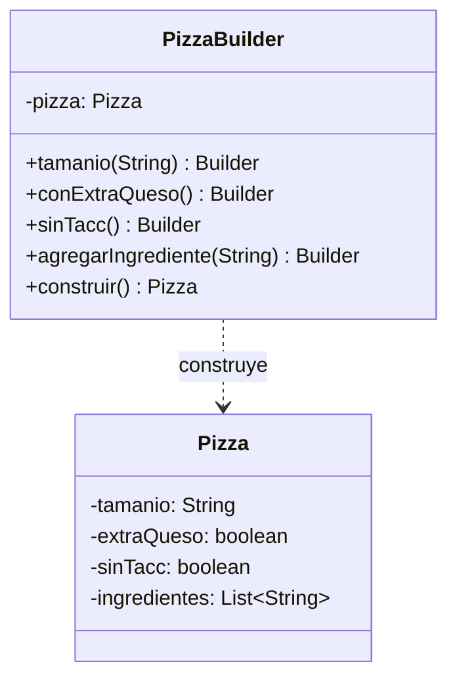
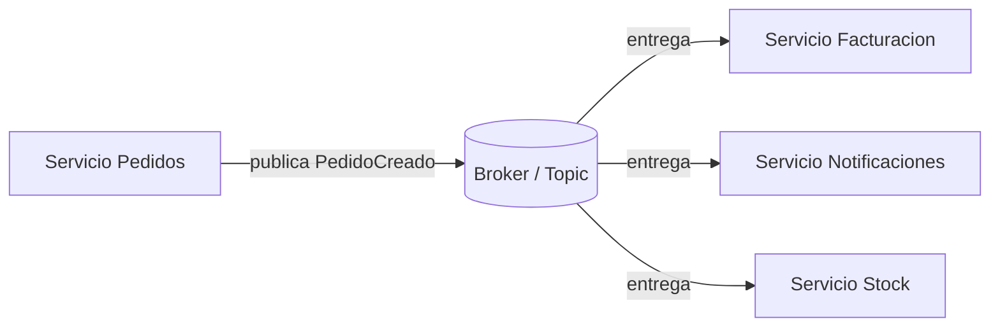
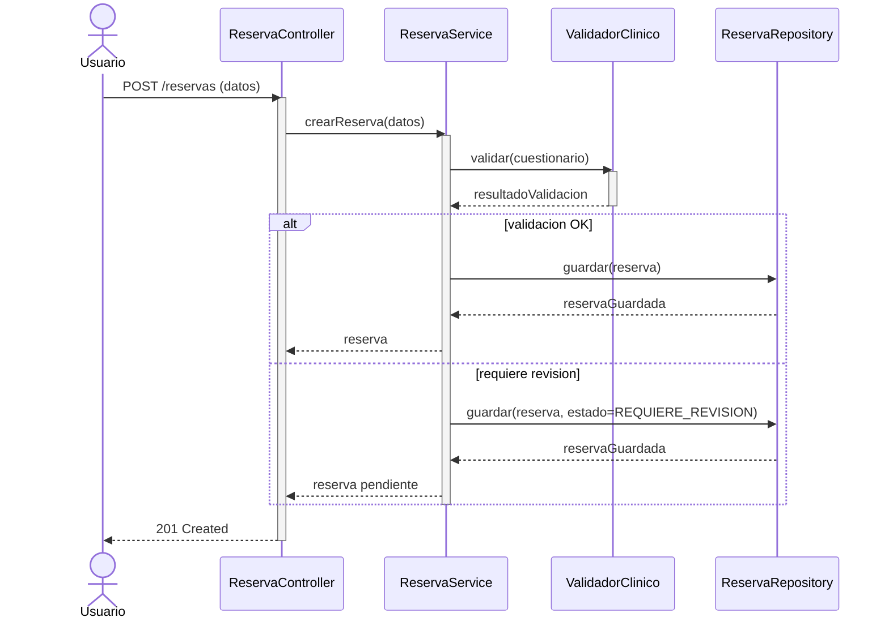
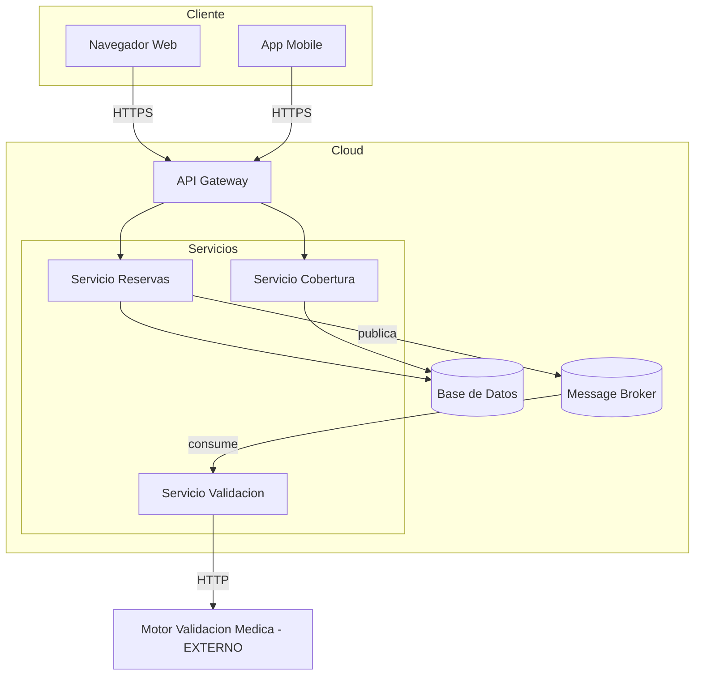
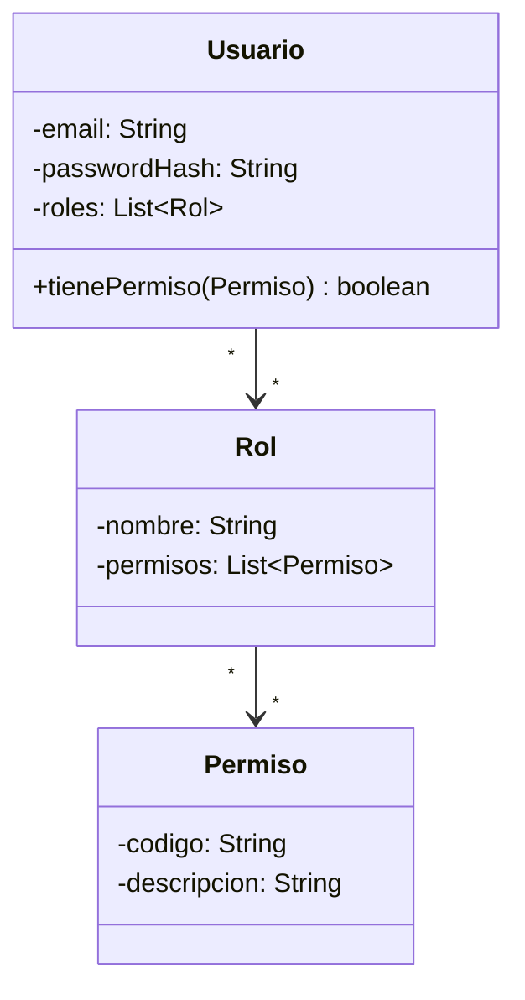

# PROMPT DE AMPLIACIÓN — Sitio de estudio "Diseño de Sistemas" (UTN FRBA)

## Contexto para Claude Code

Ya construiste el sitio siguiendo `prompt_maestro.md`. Está funcionando y completo según ese checklist. Ahora hay que **ampliarlo** por tres motivos:

1. **Faltan temas** que sí se dictaron en clase y entran al parcial (los detectamos cruzando con el cronograma oficial de la cátedra).
2. **El parcial es ESCRITO, no de codear.** El sitio hoy tiene mucho Java, que sirve para entender, pero falta practicar lo que realmente se hace el día del examen: diagramar a mano, justificar por escrito, responder V/F, escribir pseudocódigo breve.
3. Algunos ajustes menores.

**Reglas:**
- No rompas lo que ya funciona. Esto es ampliación, no reescritura.
- Mantené el mismo estilo visual, la misma plantilla de página y el mismo tono (español rioplatense, cercano, explicativo).
- Todo lo nuevo se suma al menú lateral en la sección que corresponda.
- Actualizá el buscador para que indexe las páginas nuevas.
- Actualizá el checklist de progreso en localStorage para incluir los temas nuevos.

---

# PARTE A — TEMAS FALTANTES

Estos temas están en el cronograma oficial de la cátedra (clases 1 a 16, todo el primer cuatrimestre) y **no están en el sitio**. Hay que agregarlos todos.

## A.1. Patrón Builder

Se dictó en clase 8, junto con Strategy, Adapter, Facade y Factory.

Va en la sección **🎨 Patrones de Diseño**, con la **misma plantilla de 11 pasos** que los demás.

**Intención:** separar la construcción de un objeto complejo de su representación, para que el mismo proceso de construcción pueda crear distintas representaciones.

**Analogía:** armar una hamburguesa en un local de comida rápida. Vos vas eligiendo paso a paso: el pan, la carne, el queso, los agregados, la salsa. Al final decís "listo" y te la arman. No tenés que pasarle los 12 ingredientes de una en un solo pedido gigante, y podés omitir los que no querés.

**El problema:** tenés un objeto con muchos atributos, algunos opcionales. Hacer un constructor con 10 parámetros es ilegible (¿qué era el cuarto boolean?) y armar 15 constructores distintos para cada combinación es inmantenible. A esto se le dice *telescoping constructor anti-pattern*.

**Ejemplo mal:**

```java
// Constructor telescópico: ilegible y frágil
Pizza p = new Pizza("grande", true, false, true, true, false, "napolitana");
// ¿qué significa cada boolean? ni idea sin ir a ver la clase
```

**Ejemplo bien:**

```java
class Pizza {
    private String tamanio;
    private boolean extraQueso;
    private boolean sinTacc;
    private List<String> ingredientes;

    private Pizza() {} // constructor privado

    static class Builder {
        private Pizza pizza = new Pizza();

        public Builder tamanio(String t) {
            pizza.tamanio = t;
            return this;
        }

        public Builder conExtraQueso() {
            pizza.extraQueso = true;
            return this;
        }

        public Builder sinTacc() {
            pizza.sinTacc = true;
            return this;
        }

        public Builder agregarIngrediente(String i) {
            pizza.ingredientes.add(i);
            return this;
        }

        public Pizza construir() {
            // acá se pueden validar reglas antes de devolver
            return pizza;
        }
    }
}

// Uso: se lee solo
Pizza p = new Pizza.Builder()
    .tamanio("grande")
    .conExtraQueso()
    .agregarIngrediente("jamon")
    .agregarIngrediente("morron")
    .construir();
```

**Diagrama Mermaid:**



**Palabras clave en enunciado:**
- "objeto con muchos atributos opcionales"
- "se va configurando paso a paso"
- "el usuario elige qué incluir"
- "distintas combinaciones de"
- "armar / configurar / componer antes de crear"
- "personalizable"

**Cuándo NO usarlo:** si el objeto tiene 2-3 atributos, todos obligatorios. Un constructor normal alcanza. Builder para algo simple es sobreingeniería clásica de parcial.

**Cómo justificarlo (escrito):** "Usé Builder porque [X] tiene múltiples atributos, varios de ellos opcionales, y las distintas combinaciones posibles harían inmanejable la cantidad de constructores. El Builder permite construir el objeto paso a paso de forma legible y validar la consistencia antes de instanciarlo."

**Confusión típica:**
- **Builder vs Factory:** Factory decide **qué** objeto crear (elige entre variantes). Builder decide **cómo armarlo** (paso a paso, misma clase). Si el enunciado dice "según el tipo se crea X o Y" → Factory. Si dice "el objeto se va configurando con distintas opciones" → Builder.

---

## A.2. Publicación-Suscripción y Suscripción de Eventos

Se dictó en clase 12, junto con Broker. Hoy el sitio tiene Broker pero no tiene este patrón desarrollado por separado.

Va en la sección **🔗 Integración y comunicación**.

**Intención:** desacoplar productores de eventos de sus consumidores. Los publicadores emiten eventos sin saber quién los va a recibir; los suscriptores se anotan a los tipos de evento que les interesan.

**Analogía:** un diario. El diario publica noticias sin saber quiénes son sus lectores. Los lectores se suscriben a las secciones que les interesan (deportes, política, espectáculos). El diario no le manda la noticia a cada uno personalmente; la publica y quien esté suscripto la recibe.

**Diferencia clave con Observer (esto se pregunta):**

| Aspecto | Observer | Publicación-Suscripción |
|---|---|---|
| Alcance | Dentro del mismo proceso/aplicación | Entre sistemas distribuidos |
| Acoplamiento | El subject tiene la lista de observers (los conoce) | El publicador no conoce a los suscriptores |
| Intermediario | No hay | Sí, hay un broker/canal en el medio |
| Sincronía | Generalmente sincrónico | Generalmente asincrónico |
| Ejemplo | Un botón que notifica a sus listeners | Un microservicio que publica "PedidoCreado" en Kafka |

**Conceptos:**
- **Evento:** algo que pasó y que puede interesarle a alguien. Se nombra en pasado: `PedidoCreado`, `PagoAprobado`, `UsuarioRegistrado`.
- **Publicador (publisher):** el que emite el evento.
- **Suscriptor (subscriber):** el que recibe y reacciona.
- **Topic / Canal:** la "categoría" de evento a la que uno se suscribe.
- **Broker:** la infraestructura que recibe, guarda y distribuye los eventos.

**Diagrama Mermaid:**



**Palabras clave:**
- "cuando ocurre X, varios servicios deben enterarse"
- "eventos"
- "desacoplar productores de consumidores"
- "notificar a múltiples sistemas"
- "el servicio no debe conocer a quienes consumen"

**Cómo justificarlo (escrito):** "Usé Publicación-Suscripción porque el evento [X] debe ser consumido por múltiples servicios ([A], [B], [C]) y el servicio que lo produce no debe conocerlos ni depender de ellos. Al publicar el evento en un topic del broker, se pueden sumar o quitar consumidores sin modificar al publicador."

---

## A.3. Diagramas de Secuencia

Se dictó en clase 6. **Los finales lo piden explícitamente** (ProtegePro: *"Explique mediante diagramas de secuencia cómo se realiza una reserva"*).

Nueva sección en el menú: **📐 Diagramas UML**, que va después de Fundamentos.

**Contenido obligatorio:**

**Para qué sirve:** mostrar **la interacción temporal** entre objetos para cumplir un caso de uso. Responde "¿quién le habla a quién, en qué orden?".

**Elementos:**
- **Actor:** quien inicia (usuario, sistema externo). Se dibuja como monigote.
- **Lifeline (línea de vida):** una por cada objeto/componente que participa. Es un rectángulo arriba con una línea punteada vertical hacia abajo.
- **Mensaje:** flecha horizontal de una lifeline a otra. Se etiqueta con el nombre del método.
  - Flecha llena → llamada sincrónica
  - Flecha abierta → llamada asincrónica
  - Flecha punteada ← respuesta / return
- **Barra de activación:** rectángulo fino sobre la lifeline que indica que ese objeto está ejecutando algo.
- **Self-message:** flecha que sale y vuelve al mismo objeto.
- **Fragmentos combinados:**
  - `alt` → alternativa (if/else)
  - `opt` → opcional (if sin else)
  - `loop` → repetición
  - `par` → ejecución paralela

**Ejemplo completo en Mermaid (usar este como modelo):**



**Cómo dibujarlo rápido a mano (para el parcial escrito):**
1. Poné el actor a la izquierda del todo.
2. Ordená los participantes de izquierda a derecha siguiendo el flujo (controller → service → repository → externos).
3. Dibujá las líneas de vida punteadas hacia abajo, bien largas.
4. Las flechas van de arriba hacia abajo en orden cronológico. No cruces flechas.
5. Etiquetá cada flecha con el nombre del método y sus parámetros clave.
6. Las respuestas van con flecha punteada.
7. Si hay un if, dibujá el recuadro `alt` con la condición arriba a la izquierda.
8. **No hace falta dibujar todas las barras de activación** si vas corto de tiempo; con las flechas ordenadas se entiende.

**Errores típicos en el parcial:**
- Poner clases que no participan realmente.
- Olvidar las flechas de retorno.
- Mezclar el orden temporal (las flechas de abajo tienen que pasar después que las de arriba).
- No mostrar los casos alternativos cuando el enunciado dice "suponiendo que todo salga bien" (ahí sí solo el happy path) vs cuando pide contemplar errores.

**Interactivo:** dar 4 enunciados de casos de uso y que el alumno ordene mensajes desordenados en la secuencia correcta (drag & drop vertical o "elegí el orden").

---

## A.4. Diagramas de Componentes y de Despliegue

Se dictaron en clase 1. **Casi todos los finales piden uno de estos**.

Va en la nueva sección **📐 Diagramas UML**.

### Diagrama de Componentes

**Para qué sirve:** mostrar las **piezas de software** del sistema y cómo se conectan lógicamente.

**Elementos:**
- **Componente:** rectángulo con el ícono de componente (o el estereotipo `<<component>>`). Ej: "Servicio de Reservas", "Frontend Web".
- **Interfaz provista:** el "chupetín" (círculo con línea). Lo que el componente ofrece.
- **Interfaz requerida:** el "enchufe" (semicírculo). Lo que el componente necesita.
- **Dependencia:** flecha punteada entre componentes.

**Cuándo usarlo:** cuando el enunciado pide "elabore un diagrama de componentes", o cuando querés mostrar la estructura lógica de servicios y sus dependencias.

### Diagrama de Despliegue

**Para qué sirve:** mostrar **dónde corre físicamente cada cosa**: qué servidor, qué contenedor, qué nube.

**Elementos:**
- **Nodo:** cubo 3D. Representa hardware o entorno de ejecución. Ej: "Servidor de Aplicaciones", "Cloud AWS", "Dispositivo móvil".
- **Artefacto:** lo que se despliega en el nodo (un .jar, un contenedor Docker, una imagen).
- **Conexión:** línea entre nodos, etiquetada con el protocolo (HTTP, TCP/IP, AMQP).

**Ejemplo en Mermaid (usando graph, ya que Mermaid no tiene despliegue nativo):**



**Cómo dibujarlo rápido a mano:**
1. Dividí la hoja en zonas: clientes arriba, tu sistema en el medio, externos abajo o a un costado.
2. Dibujá cada nodo como un rectángulo (no hace falta el cubo 3D perfecto).
3. Poné adentro qué corre ahí.
4. Conectá con flechas **etiquetadas con el protocolo** (HTTPS, AMQP, JDBC). Esto suma puntos.
5. Marcá claramente qué es externo (borde punteado, o etiqueta "EXTERNO").

**Lo que el corrector busca:**
- Que estén todos los servicios mencionados en el enunciado.
- Que los servicios externos estén identificados como tales.
- Que las conexiones tengan protocolo.
- Que si hay demora/picos de tráfico, aparezca una cola o mecanismo asincrónico.
- Que haya base de datos donde corresponde.

**Interactivo:** dado un enunciado, elegir qué componentes van en el diagrama (checkboxes con distractores) y después definir las conexiones.

---

## A.5. Cualidades de Diseño y Atributos de Calidad

Se dictó en clase 3. **El parcial 2023 lo pide por nombre** ("Mencione y haga referencia explícita a: Cualidades de Diseño y Atributos de Calidad de Software").

Va en la sección **🎯 Principios**.

**Diferencia entre los dos conceptos:**
- **Cualidades de diseño:** propiedades del diseño mismo (acoplamiento, cohesión, etc.).
- **Atributos de calidad:** requerimientos no funcionales del sistema (performance, disponibilidad, etc.). Normados por ISO 25010.

### Cualidades de Diseño

- **Acoplamiento:** qué tanto una clase depende de otra. **Se busca bajo acoplamiento.** Si cambiar A obliga a cambiar B, están muy acoplados.
- **Cohesión:** qué tan relacionadas están las responsabilidades dentro de una clase. **Se busca alta cohesión.** Una clase que hace una sola cosa bien es cohesiva.
- **Encapsulamiento:** ocultar los detalles internos.
- **Abstracción:** quedarse con lo esencial, ignorar el detalle irrelevante.
- **Redundancia (evitarla):** no repetir código ni conocimiento. Principio DRY.
- **Extensibilidad:** poder agregar funcionalidad sin romper lo existente.
- **Reusabilidad:** que las piezas sirvan en otros contextos.

**Frase clave para el parcial:** *"Busqué bajo acoplamiento y alta cohesión"* — es la frase más usada y bien vista en justificaciones.

### Atributos de Calidad (ISO 25010)

Los que más aparecen en parciales:

- **Performance / Eficiencia:** qué tan rápido responde, cuántos recursos consume.
- **Disponibilidad:** qué porcentaje del tiempo el sistema está operativo. Ej: "SLA de 99.9%", "máximo 10 horas caído al año".
- **Escalabilidad:** capacidad de soportar más carga.
- **Mantenibilidad:** qué tan fácil es modificar el sistema. Ej: "se debe poder agregar funcionalidad en menos de 20 horas".
- **Seguridad:** protección de la información. Ej: "las contraseñas deben hashearse con SHA2".
- **Usabilidad:** qué tan fácil de usar es.
- **Portabilidad:** correr en distintos entornos.
- **Confiabilidad:** que no falle, y si falla que se recupere.
- **Testeabilidad:** qué tan fácil es probarlo.
- **Interoperabilidad:** capacidad de comunicarse con otros sistemas.

**Cómo se pregunta en el parcial (formato real del 2023):**
> "Indique con qué atributo de calidad se corresponde mejor cada uno de los siguientes requerimientos:
> a) 'El SLA definido permite que el sistema esté caído como máximo 10 horas al año' → **Disponibilidad**
> b) 'La contraseña debe hashearse mediante SHA2' → **Seguridad**
> c) 'Se debe modificar y agregar funcionalidad con facilidad en menos de 20 horas' → **Mantenibilidad**"

**Tradeoffs (importante, se pregunta):** los atributos de calidad **compiten entre sí**. Ejemplos:
- Más seguridad → generalmente menos performance (cifrar cuesta tiempo)
- Más disponibilidad → más costo (redundancia)
- Más flexibilidad/extensibilidad → más complejidad, menos simplicidad
- Más performance → a veces menos mantenibilidad (optimizaciones hacen el código más críptico)

**Interactivo:** dar 12 frases de requerimientos y que el alumno los clasifique arrastrando al atributo de calidad correcto.

---

## A.6. Code Smells

Se dictó en clase 3 (junto con SOLID en clase 6). **El parcial 2023 lo pide explícitamente.**

Va en la sección **🎯 Principios**, junto a SOLID.

**Qué es un code smell:** un síntoma en el código que sugiere que hay un problema de diseño más profundo. No es un bug (el código funciona), es una señal de alarma.

**Los smells que más se preguntan:**

| Smell | Qué es | Cómo se arregla |
|---|---|---|
| **God Class / Large Class** | Una clase que hace demasiadas cosas | Extraer clases (aplicar SRP) |
| **Long Method** | Un método larguísimo | Extraer métodos |
| **Long Parameter List** | Un método con muchos parámetros | Introducir objeto parámetro, o Builder |
| **Duplicated Code** | El mismo código repetido | Extraer método / clase padre / Template Method |
| **Switch Statements** | Cadenas de if/else o switch sobre tipos | Polimorfismo: Strategy, State, Factory |
| **Feature Envy** | Un método usa más datos de otra clase que de la suya | Mover el método a la clase que envidia |
| **Data Class** | Clase con solo atributos y getters/setters, sin comportamiento | Mover comportamiento hacia ella (anemia del dominio) |
| **Shotgun Surgery** | Un cambio chico obliga a tocar muchas clases | Reagrupar responsabilidades |
| **Divergent Change** | Una clase cambia por muchos motivos distintos | Separarla (SRP) |
| **Primitive Obsession** | Usar String/int para todo en vez de tipos propios | Crear Value Objects |
| **Refused Bequest** | Una subclase no usa lo que heredó | Revisar la herencia, quizá va composición |
| **Inappropriate Intimacy** | Dos clases se meten demasiado en los datos de la otra | Reducir acoplamiento, mover métodos |

**Relación con SOLID:** cada smell suele violar algún principio. Marcá esa conexión explícitamente (ej: God Class viola SRP; Switch Statements suele violar OCP).

**Interactivo:** mostrar código con un smell y que el alumno lo identifique + diga qué principio SOLID viola + qué patrón lo resolvería.

---

## A.7. Inyección de Dependencias

Se dictó en clase 4.

Va en la sección **🎯 Principios** (está muy ligado a DIP de SOLID).

**Qué es:** en vez de que una clase cree sus propias dependencias, se las pasan desde afuera.

**Sin inyección:**

```java
class PedidoService {
    private PedidoRepository repo = new MySQLPedidoRepository(); // acoplado a MySQL
}
```

**Con inyección (por constructor, la forma recomendada):**

```java
class PedidoService {
    private PedidoRepository repo;

    public PedidoService(PedidoRepository repo) { // llega de afuera
        this.repo = repo;
    }
}
```

**Tipos de inyección:**
- **Por constructor** (la mejor): la dependencia es obligatoria e inmutable.
- **Por setter:** la dependencia es opcional o cambia en runtime.
- **Por campo/atributo** (`@Autowired` en el atributo): funciona pero es la peor práctica, dificulta el testing.

**Ventajas:**
- Bajo acoplamiento (dependés de la abstracción, no de la implementación).
- Testeabilidad: podés inyectar un mock en los tests.
- Flexibilidad: cambiar la implementación sin tocar la clase.

**Relación con DIP:** la inyección de dependencias es **la técnica** que permite cumplir el principio de inversión de dependencias.

**En Spring:** el framework tiene un contenedor de inyección. Cuando ponés `@Service`, `@Repository`, `@Component`, Spring crea la instancia y la inyecta donde haga falta.

**Cómo justificarlo (escrito):** "Apliqué inyección de dependencias por constructor para que [X] dependa de la abstracción [Interfaz] y no de una implementación concreta. Esto cumple el principio de inversión de dependencias (DIP), reduce el acoplamiento y permite sustituir la implementación (por ejemplo, un mock en los tests) sin modificar la clase."

---

## A.8. Biblioteca vs Framework

Se dictó en clase 4. **Apareció como V/F en el parcial 2023** ("Cuando nos referimos a un framework entendemos que se maneja el concepto de control directo").

Va en la sección **📚 Fundamentos**.

**La diferencia clave: inversión de control.**

- **Biblioteca (library):** vos la llamás cuando la necesitás. **Vos tenés el control.** Ejemplo: `Math.sqrt(9)`. Vos decidís cuándo.
- **Framework:** el framework te llama a vos. **El framework tiene el control.** Vos escribís código que el framework invoca en el momento que corresponda. Ejemplo: Spring llama a tu `@Controller` cuando llega una request.

**Frase clásica (Principio de Hollywood):** *"No nos llames, nosotros te llamamos."*

**Analogía:** una biblioteca es como una caja de herramientas: agarrás el martillo cuando querés clavar. Un framework es como trabajar en una fábrica con cinta transportadora: la cinta trae las piezas y vos hacés tu parte cuando te toca; vos no controlás la cinta.

**Ojo con la pregunta del parcial:** si dice "en un framework se maneja el concepto de control directo" → **FALSO**, porque en un framework hay **inversión de control**, no control directo. El control directo es de las bibliotecas.

**Ejemplos:**
- Bibliotecas: Apache Commons, Lodash, jQuery, Gson
- Frameworks: Spring Boot, Angular, Django, Rails

---

## A.9. Entities vs Value Objects

Se dictó en clase 6.

Va en la sección **📚 Fundamentos** o en una sección nueva de "Modelado de Dominio".

**Entity (entidad):**
- Tiene **identidad propia** que persiste en el tiempo.
- Dos entidades con los mismos atributos **son distintas** si tienen distinto ID.
- Es mutable: sus atributos cambian pero sigue siendo la misma cosa.
- Ejemplo: una `Persona`. Si cambia de nombre, de dirección, de peso, **sigue siendo la misma persona** (mismo DNI).

**Value Object (objeto de valor):**
- **No tiene identidad**, se define por sus atributos.
- Dos value objects con los mismos atributos **son el mismo**.
- Es **inmutable**: si querés cambiarlo, creás uno nuevo.
- Ejemplo: `Dinero(100, "ARS")`. Cien pesos son cien pesos, no importa cuál "instancia" sea. Si querés 200 pesos, creás otro objeto.

**Más ejemplos:**

| Concepto | Tipo | Por qué |
|---|---|---|
| Usuario | Entity | Tiene ID, persiste, cambia en el tiempo |
| Pedido | Entity | Tiene número de pedido, se le sigue el estado |
| Dirección | Value Object | Se define por calle+altura+ciudad. Dos direcciones iguales son la misma |
| Dinero | Value Object | 100 ARS es 100 ARS |
| Coordenada GPS | Value Object | Se define por lat+long |
| Rango de fechas | Value Object | Se define por desde+hasta |
| Producto | Entity | Tiene código, stock que cambia |

**Cómo decidir (regla práctica):** preguntate *"¿me importa cuál de los dos es, o solo cuánto/qué vale?"*. Si te importa cuál → Entity. Si solo te importa el valor → Value Object.

**En Java:** los value objects se implementan bien con `record` (inmutables por defecto, `equals` por valor).

**Cómo justificarlo (escrito):** "Modelé [X] como Value Object porque no tiene identidad propia: se define completamente por sus atributos y dos instancias con los mismos valores son equivalentes. Además es inmutable, lo que evita efectos colaterales."

---

## A.10. Cron Task y ejecución programada

Se dictó en clase 7 (junto a sincronismo/asincronismo).

Va en la sección **🔗 Integración y comunicación**.

**Qué es:** una tarea que se ejecuta automáticamente en momentos programados, sin que nadie la dispare manualmente.

**Cuándo se usa:**
- Procesos batch nocturnos (cuando hay poco tráfico).
- Reportes periódicos.
- Limpieza de datos viejos.
- Verificaciones periódicas (ej: "detectar usuarios inactivos hace más de 20 días").
- Cálculos costosos que no necesitan ser en tiempo real (ej: ranking mensual).

**Sintaxis cron (6 campos en Spring):**

```
 ┌───────────── segundo (0-59)
 │ ┌───────────── minuto (0-59)
 │ │ ┌───────────── hora (0-23)
 │ │ │ ┌───────────── día del mes (1-31)
 │ │ │ │ ┌───────────── mes (1-12)
 │ │ │ │ │ ┌───────────── día de la semana (0-7)
 │ │ │ │ │ │
 * * * * * *
```

Ejemplos:
- `0 0 3 * * *` → todos los días a las 3:00 AM
- `0 0 0 1 * *` → el día 1 de cada mes a medianoche
- `0 */15 * * * *` → cada 15 minutos

**En Spring Boot:**

```java
@Component
public class RevisorInactividad {

    @Scheduled(cron = "0 0 9 * * *") // todos los días a las 9 AM
    public void revisarInactivos() {
        // logica
    }
}
```
Necesita `@EnableScheduling` en la clase principal de la aplicación.

**Cómo detectarlo en un enunciado:**
- "al cierre de cada mes"
- "diariamente"
- "en horarios de poco tránsito"
- "periódicamente"
- "un proceso programado"
- "cuando lleva más de N días sin..."

**Cuidado (se pregunta):** si el proceso es pesado y corre para muchos registros, mencionar que conviene ejecutarlo en **horario de bajo tráfico** y considerar procesarlo **de a lotes** para no saturar.

---

## A.11. Mocking y Testing

Se dictó en clase 4.

Va en una sección nueva **🧪 Testing** o dentro de Fundamentos.

**Qué es un mock:** un objeto falso que simula el comportamiento de una dependencia real, para poder testear una clase de forma aislada.

**Por qué se usa:**
- No querés que tu test dependa de una base de datos real, ni de una API externa (lento, frágil, puede estar caída).
- Querés controlar exactamente qué devuelve la dependencia para probar casos específicos (¿qué pasa si el repo devuelve vacío? ¿si la API falla?).

**Tipos de dobles de prueba:**
- **Dummy:** objeto que se pasa pero no se usa.
- **Stub:** devuelve respuestas fijas preprogramadas.
- **Mock:** además verifica que se lo haya llamado como se esperaba.
- **Fake:** implementación simplificada que funciona (ej: repositorio in-memory).
- **Spy:** envuelve al objeto real y registra las llamadas.

**Relación con inyección de dependencias:** solo podés mockear si la dependencia se inyecta. Si la clase hace `new MySQLRepo()` adentro, no podés reemplazarla en el test.

**Tipos de prueba (esto también entra):**
- **Unitaria:** prueba una clase aislada, con mocks para sus dependencias. Rápida.
- **De integración:** prueba que varias piezas funcionen juntas (ej: service + repo real).
- **Funcional / End-to-end:** prueba el sistema completo desde afuera.
- **De performance:** cuánto tarda, cuánto aguanta.
- **De carga:** comportamiento con volumen esperado.
- **De stress:** comportamiento más allá del límite, para ver dónde rompe.
- **De regresión:** verifica que lo que andaba siga andando después de un cambio.

**Validación vs Verificación (se pregunta):**
- **Verificación:** ¿estamos construyendo el producto **correctamente**? (¿cumple la especificación?)
- **Validación:** ¿estamos construyendo el producto **correcto**? (¿es lo que el usuario necesita?)

---

## A.12. SDK y componentes embebidos

Se dictó en clase 8.

Va en la sección **📚 Fundamentos**.

**SDK (Software Development Kit):** conjunto de herramientas, bibliotecas, documentación y ejemplos que un proveedor te da para integrarte con su servicio.

**Diferencia con API:**
- **API:** el contrato/interfaz para comunicarte (ej: endpoints REST de Mercado Pago).
- **SDK:** el paquete que te facilita usar esa API desde tu lenguaje (ej: la librería `mercadopago-sdk-java` que envuelve esos endpoints).

Podés consumir una API sin SDK (haciendo las llamadas HTTP vos mismo), pero el SDK te ahorra trabajo.

**Componente embebido:** software de terceros que corre **dentro** de tu aplicación (no como servicio aparte). Ejemplos: una base de datos embebida (H2, SQLite), un motor de reglas, un widget de pago.

**Relación con Adapter:** cuando usás un SDK de terceros, conviene envolverlo en un Adapter propio para no acoplarte a él.

---

## A.13. Capas, Repositorios, Usuarios/Roles/Permisos

Se dictó en clase 4.

Va en la sección **📚 Fundamentos** o en "Modelado de Dominio".

### Arquitectura en capas

```
┌─────────────────────────────┐
│  Presentación (Controller)  │  ← recibe requests, valida formato, devuelve responses
├─────────────────────────────┤
│  Aplicación (Service)       │  ← orquesta el caso de uso
├─────────────────────────────┤
│  Dominio (Modelo)           │  ← reglas de negocio, entidades
├─────────────────────────────┤
│  Infraestructura (Repository)│ ← persistencia, integraciones externas
└─────────────────────────────┘
```

**Regla de dependencia:** las capas de arriba conocen a las de abajo, **nunca al revés**. El dominio no conoce al controller ni al repositorio (depende de una interfaz que el repo implementa).

**Verticalidad:** controller → service → repository. El controller no llama directo al repositorio saltándose el service.

### Patrón Repository

**Qué es:** abstrae el acceso a datos. El dominio pide "dame el pedido 123" sin saber si viene de MySQL, Mongo, un archivo o memoria.

```java
interface PedidoRepository {
    Optional<Pedido> buscarPorId(Long id);
    List<Pedido> buscarTodos();
    void guardar(Pedido pedido);
    void eliminar(Pedido pedido);
}
```

**Ventaja:** podés cambiar la implementación (in-memory para tests, MySQL en producción) sin tocar el dominio.

### Usuarios, Roles y Permisos

Modelo típico:



**Por qué roles en el medio:** si asignaras permisos directo a cada usuario, tendrías que actualizar a mano a cada uno cuando cambia una política. Con roles, cambiás el rol y todos los usuarios de ese rol se actualizan.

---

## A.14. Ampliar la página de Seguridad

La página de Seguridad ya existe, pero le faltan temas de la clase 14. **Agregarle estas secciones:**

### Modelos de control de acceso

- **DAC (Discretionary Access Control):** el dueño del recurso decide quién accede. Ej: permisos de archivos en Linux.
- **MAC (Mandatory Access Control):** el sistema impone las reglas según clasificaciones. Ej: militar (confidencial/secreto/ultrasecreto).
- **RBAC (Role-Based Access Control):** los permisos se asignan a roles, y los roles a usuarios. **El más común en sistemas de gestión.**
- **ABAC (Attribute-Based Access Control):** las decisiones se toman evaluando atributos (del usuario, del recurso, del contexto). Más flexible pero más complejo. Ej: "puede acceder si es médico Y está en horario laboral Y el paciente está asignado a él".

**Cuándo proponer cada uno en un parcial:**
- Si el enunciado menciona roles claros (admin, usuario, entidad) → RBAC
- Si menciona condiciones contextuales (horario, ubicación, relación con el recurso) → ABAC

### Componentes de seguridad

- **SSO (Single Sign-On):** un solo login sirve para varios sistemas. El usuario se autentica una vez.
- **IDM / IAM (Identity Management):** sistema centralizado que administra identidades, credenciales y permisos. Ejemplos: Keycloak, Auth0, Okta, AWS Cognito.
- **WAF (Web Application Firewall):** filtra tráfico HTTP malicioso antes de que llegue a la aplicación. Protege contra SQL injection, XSS, etc.
- **API Gateway con autenticación:** valida el token antes de rutear al servicio interno.

**Cómo se pregunta:** *"¿Qué componente propone para permitir el inicio de sesión de los usuarios del Sistema?"* → un **IDM/proveedor de identidad** externo (Keycloak, Auth0), con **SSO** si hay varios sistemas. Justificar: delegás la complejidad de la seguridad a un componente especializado, evitás implementar mal el manejo de contraseñas, y ganás features (MFA, recuperación, auditoría).

*"¿Qué mecanismo de seguridad podría implementar para brindar confidencialidad en los datos almacenados?"* → **cifrado en reposo** (encryption at rest) a nivel de base de datos o de campo. Para datos sensibles específicos (ej: historia clínica), cifrado a nivel campo con claves gestionadas por un KMS. Mencionar que las contraseñas van **hasheadas** (no cifradas) con bcrypt/Argon2.

### Desarrollo seguro

- **Validar toda entrada** del usuario (nunca confiar).
- **Consultas parametrizadas** (prepared statements) para evitar SQL injection.
- **Escapar salidas** para evitar XSS.
- **Principio de menor privilegio:** cada componente tiene solo los permisos que necesita.
- **Defensa en profundidad:** varias capas de seguridad, no una sola.
- **No hardcodear secretos** en el código (usar variables de entorno o un vault).

---

## A.15. Edge Computing y Disponibilidad

Se dictó en clase 13.

Va en la sección **🔗 Integración y comunicación** o en Arquitectura Web.

**Edge computing:** procesar datos **cerca de donde se generan** en vez de mandarlos todos a un servidor central.

**Analogía:** en vez de mandar todos los videos de las cámaras de seguridad a la nube para que analice si hay movimiento, cada cámara detecta el movimiento localmente y solo manda el video cuando hay algo. Ahorrás ancho de banda y respondés más rápido.

**Cuándo conviene:**
- Latencia crítica (no podés esperar el ida y vuelta a la nube).
- Mucho volumen de datos que no vale la pena transmitir entero.
- Necesitás que funcione aunque se corte la conexión.
- Privacidad (los datos no salen del dispositivo).

**Ejemplos:** cámaras inteligentes, autos autónomos, IoT industrial, CDN (que es una forma de edge para contenido estático).

### Disponibilidad (profundizar)

- **Alta disponibilidad (HA):** el sistema sigue funcionando ante fallas. Se logra con redundancia.
- **SLA (Service Level Agreement):** compromiso formal de disponibilidad. 99.9% = ~8.7 hs caído al año. 99.99% = ~52 min.
- **Punto único de falla (SPOF):** componente cuyo fallo tira todo el sistema. Se elimina duplicando.
- **Failover:** cuando falla un componente, otro toma su lugar automáticamente.
- **Circuit Breaker:** patrón que corta las llamadas a un servicio que está fallando, para no arrastrar la caída. Después reintenta gradualmente.
- **Degradación elegante:** si un servicio secundario falla, el sistema sigue funcionando con funcionalidad reducida en vez de caerse entero.

---

# PARTE B — ADAPTACIÓN A PARCIAL ESCRITO

**Contexto crítico:** el parcial es **escrito**, no se codea en una computadora. El alumno va a tener que:
- Dibujar diagramas UML a mano en papel
- Escribir justificaciones en prosa, en pocas líneas
- Responder V/F con justificación
- Escribir pseudocódigo breve cuando lo pidan
- Elegir y defender decisiones de diseño

El sitio hoy tiene 44 bloques de código Java, que están bien **para entender**, pero **la práctica tiene que apuntar a lo que se hace en el examen**.

## B.1. Agregar a CADA página de patrón: "Cómo dibujarlo rápido a mano"

Nueva sección en la plantilla de cada patrón (va después del diagrama Mermaid).

Contenido: 4-6 bullets con instrucciones concretas de dibujo. Ejemplo para Strategy:

> **Cómo dibujarlo rápido a mano**
> 1. Dibujá primero la interfaz arriba (rectángulo con `<<interface>>` arriba del nombre).
> 2. Debajo, las 2-3 implementaciones concretas en fila.
> 3. Conectalas a la interfaz con flechas punteadas de punta hueca (realización).
> 4. A un costado, la clase contexto que tiene la estrategia como atributo.
> 5. Flecha llena del contexto a la interfaz (asociación), etiquetada con el nombre del atributo.
> 6. **Tip de tiempo:** no hace falta poner todos los atributos de cada clase concreta. Con el método de la interfaz alcanza para que se entienda el patrón.

Hacé esto para los 11 patrones (incluyendo Builder).

## B.2. Agregar a CADA página de patrón: "Justificación modelo escrita"

Ya existe algo de esto ("cómo justificarlo"), pero hay que **reforzarlo y estandarizarlo**.

Formato: un recuadro destacado con una justificación de 3-5 líneas, escrita como se escribiría en el parcial, con los espacios variables marcados en `[corchetes]` para adaptar.

Ejemplo:

> **📝 Justificación modelo (copiala y adaptala)**
>
> "Apliqué el patrón **Strategy** para resolver el cálculo de `[X]`. El enunciado menciona que existen `[N]` formas distintas de calcularlo y que en el futuro podrían agregarse más. Al encapsular cada algoritmo en una clase que implementa la interfaz `[NombreInterfaz]`, se cumple el principio **Open/Closed**: agregar una nueva variante no requiere modificar el código existente, solo sumar una clase nueva. Además, esto favorece el **bajo acoplamiento**, ya que la clase `[Contexto]` solo conoce la abstracción y no las implementaciones concretas."

Fijate que la justificación modelo:
- Nombra el patrón
- Cita el enunciado ("el enunciado menciona que...")
- Menciona un principio SOLID
- Menciona una cualidad de diseño (bajo acoplamiento / alta cohesión)

**Esos 4 elementos son lo que busca el corrector.** Hacelo explícito en el sitio.

## B.3. NUEVO INTERACTIVO: "Escribí la justificación"

Nueva página en **🎮 Práctica interactiva**.

**Cómo funciona:**
1. Se muestra un enunciado corto + una decisión de diseño ya tomada (ej: "usaste Strategy para el cálculo de descuentos").
2. El alumno escribe en un textarea su justificación (3-5 líneas).
3. Al enviar, el sistema **evalúa por palabras clave**: chequea si mencionó el nombre del patrón, si citó el enunciado, si nombró un principio SOLID, si mencionó una cualidad de diseño.
4. Muestra un checklist de qué elementos incluyó y cuáles le faltaron.
5. Muestra la justificación modelo para comparar.

**Implementación de la corrección:** array de palabras clave esperadas por caso, con categorías:

```javascript
{
  id: 1,
  enunciado: "...",
  decision: "Usaste Strategy para el cálculo de descuentos",
  criterios: [
    { categoria: "Nombra el patrón", keywords: ["strategy", "estrategia"], peso: 25 },
    { categoria: "Cita el enunciado", keywords: ["enunciado", "menciona", "requiere", "futuro", "agregarse"], peso: 25 },
    { categoria: "Menciona principio SOLID", keywords: ["open/closed", "open closed", "ocp", "abierto", "cerrado", "solid"], peso: 25 },
    { categoria: "Menciona cualidad de diseño", keywords: ["acoplamiento", "cohesión", "cohesion", "extensib", "mantenib"], peso: 25 }
  ],
  modelo: "Apliqué el patrón Strategy porque..."
}
```

**Cantidad mínima:** 15 casos, cubriendo los patrones principales + decisiones de arquitectura.

## B.4. NUEVO INTERACTIVO: "Verdadero o Falso con justificación"

Nueva página en **🎮 Práctica interactiva**.

Este es **el formato exacto** del parcial 2023 (punto 2 de teoría, 15 puntos).

**Cómo funciona:**
1. Se muestra una afirmación.
2. El alumno elige Verdadero o Falso.
3. Escribe su justificación en un textarea.
4. Al enviar: se le dice si acertó el V/F, y se muestra la justificación modelo para que compare.

**Casos obligatorios (usar los del parcial 2023 + más):**

| Afirmación | Respuesta | Justificación modelo |
|---|---|---|
| "El Diseño de Software incluye al Diseño de Sistemas" | **FALSO** | Es al revés: el Diseño de Sistemas de Información es más abarcativo, incluye al diseño de software pero también hardware, procesos, personas, datos e infraestructura. |
| "El atributo de calidad 'disponibilidad' no se encuentra categorizado en la norma ISO 25000" | **FALSO** | La disponibilidad sí está contemplada en ISO 25010 (parte de la familia 25000), dentro de la característica de Fiabilidad. |
| "El patrón Composite es posible implementarlo en un lenguaje funcional como Haskell" | **VERDADERO** | Los patrones son soluciones conceptuales, no atadas a un paradigma. En Haskell se puede modelar la estructura recursiva con tipos algebraicos de datos (sum types) y funciones que operan uniformemente sobre hojas y nodos. |
| "La ejecución de un testing que encuentra fallas es producto de que su diseño fue el correcto" | **VERDADERO** | Un test que encuentra una falla cumplió su objetivo: los tests se diseñan justamente para revelar defectos. Un test bien diseñado es el que tiene alta probabilidad de encontrar errores, no el que siempre pasa. |
| "Cuando nos referimos a un framework entendemos que se maneja el concepto de control directo" | **FALSO** | En un framework hay **inversión de control**: el framework llama a nuestro código, no al revés. El control directo corresponde a las bibliotecas. |
| "Los requerimientos funcionales hacen referencia a atributos de calidad" | **FALSO** | Los atributos de calidad se corresponden con los requerimientos **no funcionales**. Los funcionales describen qué debe hacer el sistema. |

**Agregar al menos 20 casos más** cubriendo: patrones, SOLID, arquitectura, HTTP, seguridad, testing.

## B.5. NUEVO INTERACTIVO: "Pseudocódigo breve"

Nueva página en **🎮 Práctica interactiva**.

El parcial 2023 pide: *"Muestre mediante código o pseudocódigo cómo fueron resueltos los siguientes requerimientos"*.

**Cómo funciona:**
1. Se da un requerimiento concreto ("permitir que las entidades configuren las acciones a ejecutar en cada estado").
2. El alumno escribe pseudocódigo en un textarea (5-15 líneas).
3. Al enviar, se muestra la solución modelo + un checklist de elementos que debía tener.
4. El alumno se autocorrige marcando qué incluyó.

**Cantidad mínima:** 10 casos.

**Importante — enseñar el formato de pseudocódigo aceptable:**

> **Cómo escribir pseudocódigo en un parcial**
> - No hace falta que compile. No pierdas tiempo en imports, getters, ni `public static void`.
> - Sí tiene que quedar claro: qué clases participan, qué métodos se llaman y en qué orden.
> - Usá nombres descriptivos.
> - Mostrá el polimorfismo si el patrón lo requiere.
> - 10-15 líneas alcanzan. Si escribís 50, perdiste tiempo.
>
> **Ejemplo de nivel adecuado:**
> ```
> class SolicitudTramite {
>     estado: EstadoSolicitud
>     acciones: Map<Estado, List<Accion>>
>
>     cambiarEstado(nuevoEstado, motivo) {
>         registrarEnHistorial(estadoActual, nuevoEstado, motivo, fechaActual)
>         this.estado = nuevoEstado
>         para cada accion en acciones.get(nuevoEstado):
>             accion.ejecutar(this)
>     }
> }
> ```

## B.6. Reformular el Simulacro de parcial

El simulacro hoy asume que se resuelve en la app. Cambialo a:

**Nuevo flujo:**
1. El alumno elige un final/parcial.
2. Se muestra el enunciado completo + un timer configurable (3 hs por defecto).
3. Un cartel claro: **"Resolvelo en papel, como en el parcial real."** Con recomendación de tener a mano hojas y lápiz.
4. Mientras corre el timer, el enunciado queda visible pero **la solución está bloqueada**.
5. Al terminar (o cuando el alumno da "terminé"), se desbloquea la solución modelo.
6. **Rúbrica de autocorrección:** checklist detallado por punto, con puntaje. El alumno marca qué hizo bien.
7. Se guarda el resultado en localStorage y se muestra la evolución de sus simulacros.

**La rúbrica tiene que ser específica.** Ejemplo para un punto de modelado:

```
Punto 2 - Modelado de Dominio (30 puntos)

[ ] Identifiqué todas las clases mencionadas en el enunciado (5 pts)
[ ] Las relaciones tienen el tipo correcto (asociación/composición/herencia) (5 pts)
[ ] Puse multiplicidades donde corresponde (3 pts)
[ ] Apliqué el patrón Strategy para las reglas de cobertura (5 pts)
[ ] Modelé la bitácora con trazabilidad (fecha + evento + responsable) (5 pts)
[ ] Justifiqué cada decisión de diseño mencionando principios (7 pts)
```

## B.7. Reducir el protagonismo del código Java

**No borres los ejemplos Java** (sirven para entender), pero:

1. **Colapsalos por defecto.** Cada bloque de código Java va dentro de un `<details>` con el resumen "Ver implementación en Java (opcional)". Así el que quiere lo abre, y el que estudia para el escrito no se distrae.
2. **Agregá arriba de cada bloque colapsado una aclaración:** *"El parcial es escrito, no vas a tener que escribir esto. Está acá para que entiendas cómo funciona el patrón por dentro."*
3. **Priorizá el diagrama por sobre el código** en el orden visual: el diagrama Mermaid va **antes** que el código, no después.

---

# PARTE C — REVISIONES Y AJUSTES MENORES

## C.1. Verificar Mermaid

Ya está reportado que no se pudo verificar visualmente. Antes de dar por cerrada la ampliación:
- Abrí el sitio en el navegador.
- Recorré todas las páginas con diagramas.
- Verificá que los 53 diagramas existentes + los nuevos rendericen.
- Los que fallen, corregí la sintaxis.

**Errores comunes en Mermaid que rompen el render:**
- Paréntesis sin escapar dentro de nombres de nodo
- Guiones o caracteres especiales en IDs
- `List<Tipo>` en classDiagram (hay que escribirlo `List~Tipo~`)
- Espacios en los IDs de nodos en `graph`

## C.2. Actualizar el menú lateral

El menú tiene que quedar así después de la ampliación:

```
🏠 Inicio
📚 Fundamentos
   ├─ Paradigma Orientado a Objetos
   ├─ Cliente-Servidor
   ├─ Arquitectura Web
   ├─ HTTP
   ├─ API / API REST
   ├─ Biblioteca vs Framework          [NUEVO]
   ├─ SDK y componentes embebidos      [NUEVO]
   ├─ Capas y Repositorios             [NUEVO]
   └─ Entities vs Value Objects        [NUEVO]
📐 Diagramas UML                        [SECCIÓN NUEVA]
   ├─ Diagrama de Clases (repaso de notación)
   ├─ Diagrama de Secuencia            [NUEVO]
   ├─ Diagrama de Componentes          [NUEVO]
   └─ Diagrama de Despliegue           [NUEVO]
🎯 Principios
   ├─ SOLID
   ├─ Cualidades y Atributos de Calidad [NUEVO]
   ├─ Code Smells                       [NUEVO]
   ├─ Inyección de Dependencias         [NUEVO]
   └─ Seguridad de la Información       [AMPLIAR]
🎨 Patrones de Diseño
   ├─ ¿Cómo elegir un patrón?
   ├─ Adapter
   ├─ Builder                           [NUEVO]
   ├─ Composite
   ├─ Facade
   ├─ Strategy
   ├─ Simple Factory y Factory Method
   ├─ Observer
   ├─ State
   ├─ Template Method
   └─ Command
🔗 Integración y comunicación
   ├─ Sincronismo vs Asincronismo
   ├─ Cron Task y ejecución programada  [NUEVO]
   ├─ Orquestación (Casos de Uso)
   ├─ Publicación-Suscripción           [NUEVO]
   ├─ Patrones de comunicación y Broker
   └─ Edge Computing y Disponibilidad   [NUEVO]
🧪 Testing                               [SECCIÓN NUEVA]
   ├─ Tipos de pruebas
   ├─ Mocking y dobles de prueba
   └─ Validación vs Verificación
🎮 Práctica interactiva
   ├─ Detector de patrones
   ├─ Spot the SOLID smell
   ├─ Armá el diagrama
   ├─ Escribí la justificación          [NUEVO]
   ├─ Verdadero o Falso                 [NUEVO]
   ├─ Pseudocódigo breve                [NUEVO]
   ├─ Flashcards
   ├─ Comparador de diagramas
   ├─ Preguntas de teoría
   └─ Simulacro de parcial              [REFORMULAR]
📝 Finales resueltos
   └─ (los 6 que ya están)
🃏 Cheatsheets
   ├─ Palabras clave por patrón          [AMPLIAR con Builder]
   ├─ SOLID en 1 hoja
   ├─ HTTP en 1 hoja
   ├─ Notación UML en 1 hoja             [NUEVO]
   └─ Frases para justificar             [NUEVO]
```

## C.3. Nuevos cheatsheets

### Cheatsheet: Notación UML en 1 hoja

Tabla visual con todas las notaciones que se usan en el parcial:

| Elemento | Cómo se dibuja | Cuándo se usa |
|---|---|---|
| Clase | Rectángulo con 3 compartimentos | Siempre |
| Interfaz | `<<interface>>` arriba del nombre | Contratos |
| Clase abstracta | Nombre en *cursiva* | Cuando no se instancia directo |
| Método abstracto | Nombre en *cursiva* | Lo implementan las subclases |
| Visibilidad | `+` público, `-` privado, `#` protegido | En atributos y métodos |
| Asociación | Línea simple, flecha si es dirigida | "conoce a" |
| Agregación | Rombo vacío | "tiene un/a" pero puede existir sin él |
| Composición | Rombo lleno | "está compuesto por", no existe sin el todo |
| Herencia | Flecha con punta triangular vacía, línea llena | "es un/a" |
| Realización | Flecha con punta triangular vacía, línea punteada | Implementa una interfaz |
| Dependencia | Flecha punteada abierta | "usa" (parámetro, variable local) |
| Multiplicidad | `1`, `*`, `0..1`, `1..*` | En los extremos de la relación |
| Estereotipo | `<<record>>`, `<<service>>`, `<<enum>>` | Para aclarar el tipo |

Más una sección de "errores de notación que restan puntos".

### Cheatsheet: Frases para justificar

Una hoja con **frases modelo listas para adaptar**, agrupadas:

**Para justificar un patrón:**
- "Apliqué [patrón] porque el enunciado indica que [cita], lo cual requiere [necesidad]."
- "Esto cumple el principio [SOLID] ya que [explicación]."
- "Favorece el bajo acoplamiento porque [X] solo conoce la abstracción [Y]."

**Para justificar NO usar un patrón:**
- "Evité aplicar [patrón] porque en este caso solo existe [una variante / un tipo], y agregar esa abstracción sería sobreingeniería sin beneficio."
- "Preferí una solución más simple porque el enunciado no menciona necesidad de extensión en este punto."

**Para arquitectura:**
- "Propuse comunicación asincrónica mediante [cola/broker] porque el enunciado indica que [el servicio puede demorar / hay picos de tráfico], y una llamada sincrónica generaría timeouts y acoplamiento temporal."
- "Incorporé [componente] para eliminar el punto único de falla en [X]."

**Para persistencia:**
- "Elegí persistencia [relacional/no relacional] para [X] porque [los datos tienen estructura fija y relaciones / el esquema es variable y se consulta por documento completo]."
- "Desnormalicé [X] porque se consulta con mucha frecuencia junto a [Y] y la performance de lectura es prioritaria."

## C.4. Ampliar el Detector de patrones

Agregar casos para los patrones/temas nuevos:
- Builder (mínimo 3 casos)
- Publicación-Suscripción vs Observer (mínimo 3 casos, para practicar la distinción)
- Casos donde la respuesta correcta sea **"ninguno, no hace falta patrón"** (mínimo 3). Esto es importantísimo: enseña a no sobreingenierizar.

Total nuevo del detector: 34 existentes + 9 nuevos = **43 casos**.

## C.5. Ampliar las flashcards

Agregar tarjetas para:
- Builder
- Publicación-Suscripción
- Cada tipo de diagrama UML (secuencia, componentes, despliegue) con "para qué sirve"
- Cada cualidad de diseño (acoplamiento, cohesión, etc.)
- Cada atributo de calidad
- Los code smells principales
- Entity vs Value Object
- Biblioteca vs Framework
- Tipos de prueba
- Modelos de control de acceso (RBAC, ABAC)

Total nuevo: 68 existentes + ~35 nuevas = **~103 flashcards**.

## C.6. Actualizar la landing

La ruta "🚀 Voy desde cero" tiene que incluir los temas nuevos en el orden correcto:

```
Fundamentos → Diagramas UML → Principios → Patrones → Integración → Testing → Práctica → Finales
```

Y agregar en la landing un **aviso destacado**: *"⚠️ El parcial es ESCRITO. Los ejemplos en Java están para que entiendas los conceptos, pero la práctica del sitio apunta a lo que vas a hacer el día del examen: diagramar a mano, justificar por escrito y responder teoría."*

---

# CHECKLIST DE LA AMPLIACIÓN

- [ ] Builder agregado con plantilla completa
- [ ] Publicación-Suscripción agregado
- [ ] Sección nueva "📐 Diagramas UML" con secuencia, componentes y despliegue
- [ ] Cualidades de Diseño y Atributos de Calidad
- [ ] Code Smells
- [ ] Inyección de Dependencias
- [ ] Biblioteca vs Framework
- [ ] Entities vs Value Objects
- [ ] Cron Task
- [ ] Sección nueva "🧪 Testing" (tipos de prueba, mocking, validación vs verificación)
- [ ] SDK y componentes embebidos
- [ ] Capas, Repositorios, Usuarios/Roles/Permisos
- [ ] Página de Seguridad ampliada (RBAC/ABAC/SSO/IDM/WAF/desarrollo seguro)
- [ ] Edge Computing y Disponibilidad
- [ ] "Cómo dibujarlo rápido a mano" en los 11 patrones
- [ ] "Justificación modelo escrita" reforzada en los 11 patrones
- [ ] Interactivo nuevo: Escribí la justificación (15 casos)
- [ ] Interactivo nuevo: Verdadero o Falso (26 casos)
- [ ] Interactivo nuevo: Pseudocódigo breve (10 casos)
- [ ] Simulacro reformulado para papel + rúbrica detallada
- [ ] Código Java colapsado con `<details>` y aclaración
- [ ] Diagramas Mermaid antes del código, no después
- [ ] Menú lateral actualizado con todas las secciones
- [ ] Cheatsheet nuevo: Notación UML
- [ ] Cheatsheet nuevo: Frases para justificar
- [ ] Detector ampliado a 43 casos (incluye "ninguno")
- [ ] Flashcards ampliadas a ~103
- [ ] Landing actualizada con aviso de parcial escrito
- [ ] Buscador indexa las páginas nuevas
- [ ] Progreso en localStorage incluye los temas nuevos
- [ ] **Todos los diagramas Mermaid verificados en navegador**

---

Trabajá con el mismo cuidado que la primera vez. Si tenés que dividir en tandas, hacelo, pero no dejes secciones a medias.
