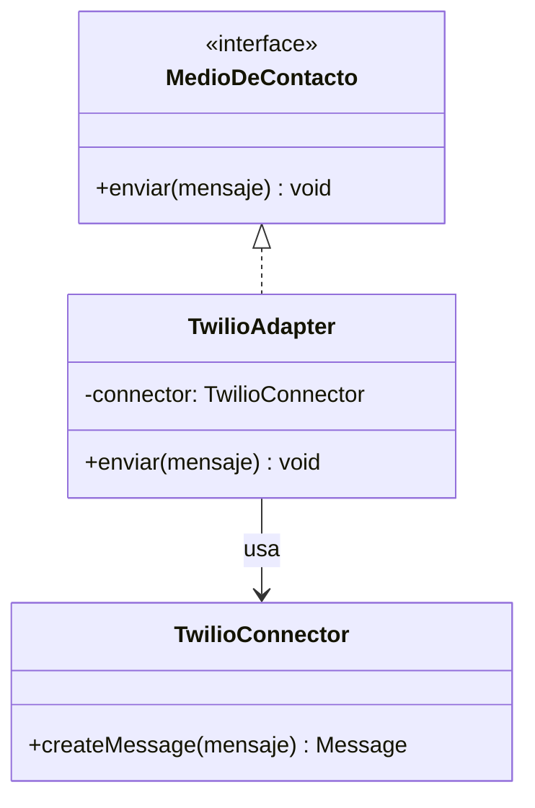
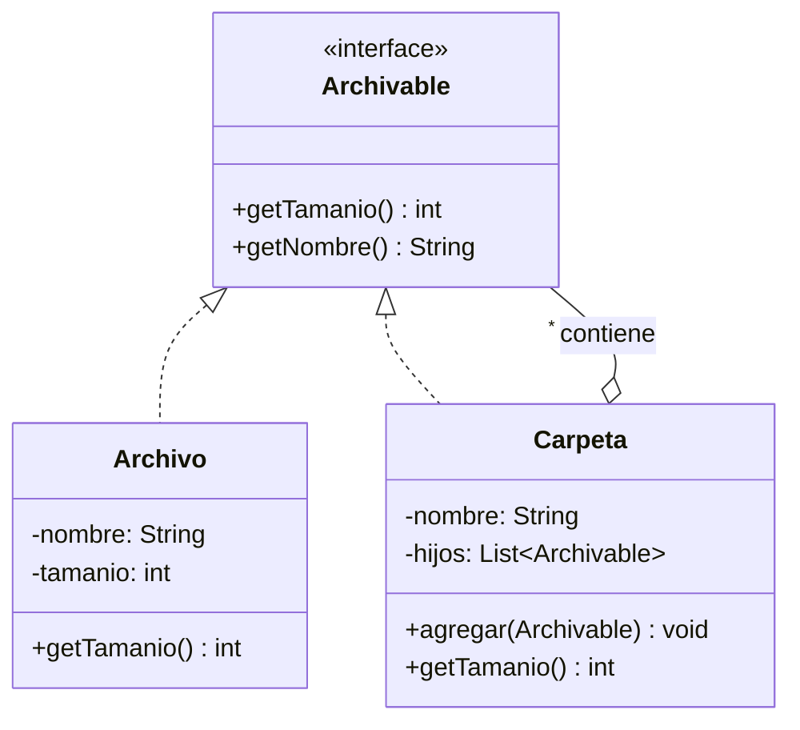
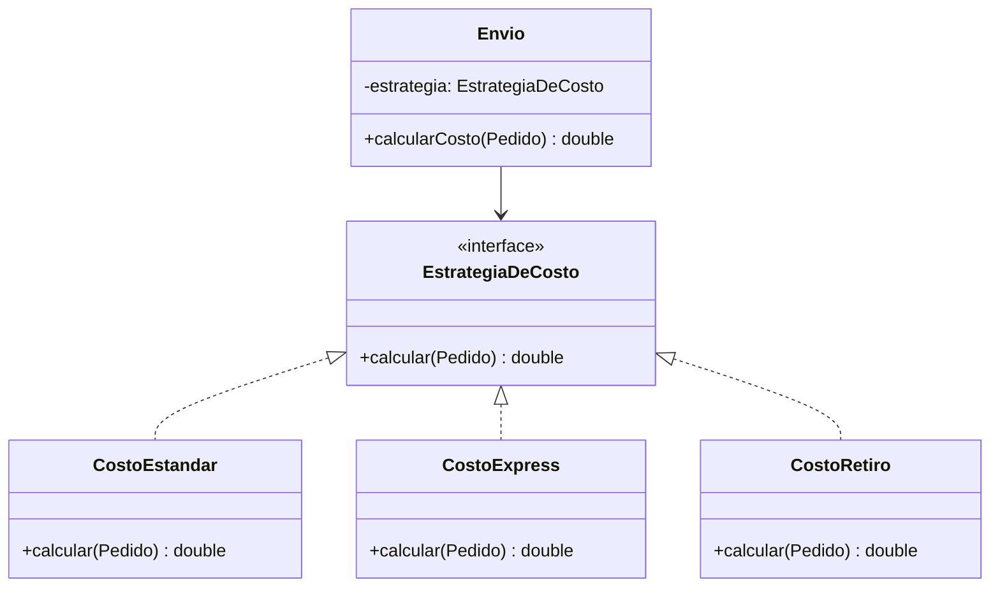
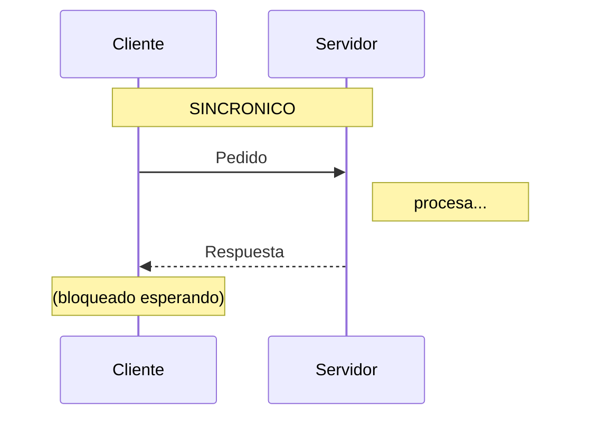
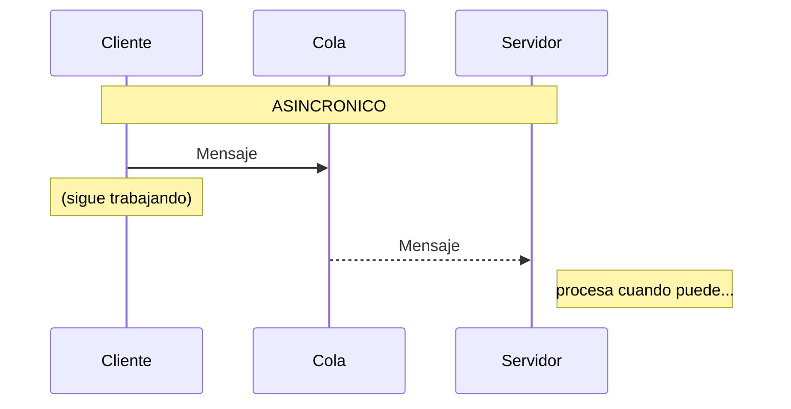
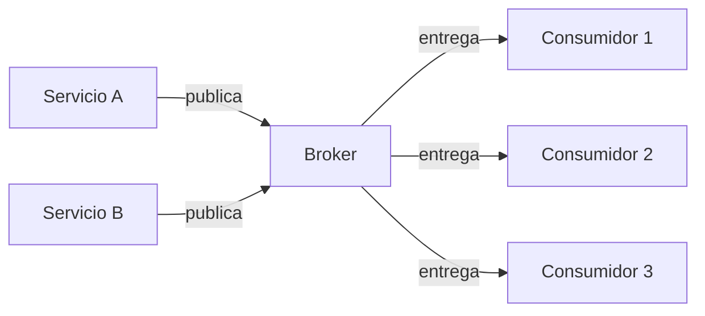

# PROMPT MAESTRO — Sitio de estudio: "Diseño de Sistemas" (UTN FRBA, Plan 23) — Primer Parcial

## Instrucciones para Claude Code

Sos Claude Code y vas a construir un **sitio web educativo completo** para preparar el primer parcial de la materia **Diseño de Sistemas de Información** (UTN FRBA, Plan 23). El sitio tiene que servir tanto para alguien que arranca desde cero como para alguien que quiere repasar antes del parcial.

Este prompt te da **todo el contenido, la estructura, la pedagogía y los interactivos** que tenés que armar. Seguilo tal cual, en el orden en que está. Si alguna sección te parece que se puede mejorar, agregala como extra pero **nunca omitas nada de lo pedido**.

**Idioma:** español rioplatense (voseo, "vos" en vez de "tú"). Tono cercano, explicativo, sin ser condescendiente.

**Alcance:** solo los temas del primer parcial (listados abajo). El sitio no cubre temas del segundo parcial.

---

## 1. Stack técnico

- **HTML5 + CSS3 + JavaScript vanilla.** Nada de React, Vue ni frameworks pesados. La razón: portabilidad, simplicidad, y que se abra bien desde el navegador local.
- **Librerías permitidas (por CDN, sin build):**
  - **Mermaid.js** (última versión estable) para diagramas UML embebidos y renderizados en el navegador
  - **Prism.js** para syntax highlighting de código Java
  - **Chart.js** solo si hace falta algún gráfico
- **Sin backend.** Todo el estado (progreso de ejercicios, respuestas guardadas) va en `localStorage`.
- **Responsive.** Tiene que verse bien en desktop y en mobile (aunque el uso principal es desktop).
- **Modo claro y modo oscuro.** Toggle en la esquina superior, y respetar la preferencia del sistema (`prefers-color-scheme`).

---

## 2. Estructura del sitio

Landing page principal con menú lateral fijo a la izquierda. El contenido a la derecha. Layout tipo "wiki" o "docs" (parecido a Notion, Docusaurus o refactoring.guru).

### 2.1. Menú principal (sidebar)

```
🏠 Inicio
📚 Fundamentos
   ├─ Paradigma Orientado a Objetos
   ├─ Cliente-Servidor
   ├─ Arquitectura Web
   ├─ HTTP
   └─ API / API REST
🎯 Principios
   ├─ SOLID
   └─ Seguridad de la Información
🎨 Patrones de Diseño
   ├─ ¿Cómo elegir un patrón? (decision tree)
   ├─ Adapter
   ├─ Composite
   ├─ Facade
   ├─ Strategy
   ├─ Simple Factory y Factory Method
   ├─ Observer
   ├─ State
   ├─ Template Method
   └─ Command
🔗 Integración y comunicación
   ├─ Sincronismo vs Asincronismo
   ├─ Orquestación (Casos de Uso)
   └─ Patrones de comunicación y Broker
🎮 Práctica interactiva
   ├─ Detector de patrones (juego)
   ├─ Spot the SOLID smell
   ├─ Armá el diagrama
   ├─ Flashcards
   └─ Comparador de diagramas
📝 Finales resueltos y para practicar
   ├─ Final resuelto: ProtegePro
   ├─ Final resuelto: Libros Circulares
   ├─ Final resuelto: TurnoÁgil
   ├─ Final resuelto: Talentia
   ├─ Final resuelto: La Scalo App
   └─ Parcial resuelto: GTV
🃏 Cheatsheets (imprimibles)
   ├─ Palabras clave por patrón
   ├─ SOLID en 1 hoja
   └─ HTTP en 1 hoja
```

### 2.2. Estructura de cada página de tema

Cada página de tema (patrón, principio, concepto) sigue **la misma plantilla**, en este orden:

1. **Título grande + subtítulo con la "intención" del patrón** (una frase corta)
2. **Analogía con el mundo real** (recuadro destacado, con emoji)
3. **El problema que resuelve** (2-3 párrafos con un caso concreto)
4. **Ejemplo mal resuelto** (código Java sin el patrón, con comentarios que marcan los problemas)
5. **Ejemplo bien resuelto** (código Java con el patrón, más el diagrama UML en Mermaid)
6. **Diagrama UML interactivo** — clases clickeables que muestran su rol al hacer hover
7. **Palabras clave para detectarlo en un enunciado** (lista con ejemplos concretos)
8. **Cuándo NO usarlo** (sección crítica, muchos alumnos se pasan)
9. **Cómo justificarlo en un parcial** (frases modelo tipo "usé X porque el enunciado dice...")
10. **Confusión típica con otros patrones** (comparación lado a lado)
11. **Mini-ejercicio interactivo** al final (leer enunciado y elegir si aplica)

Este orden **no es negociable**: es la progresión que la investigación en enseñanza de patrones muestra como más efectiva (analogía → problema → antipatrón → solución → aplicación).

---

## 3. Principios pedagógicos (para todo el sitio)

### 3.1. Reglas de contenido

- **Cada concepto abstracto arranca con una analogía del mundo real.** No definiciones formales primero. Ejemplo: para Observer, arrancar con "cuando te suscribís a un canal de YouTube y recibís notificación cuando sube video", no con "define una dependencia uno-a-muchos".
- **Progresión: intuitivo → formal → aplicado.** Primero mostrás cómo se siente el problema, después el nombre técnico, después cómo se resuelve, después cómo se aplica.
- **Contraejemplos son tan importantes como ejemplos.** Cada patrón tiene una sección "cuándo NO usarlo" con un caso donde meterlo es sobreingeniería.
- **Frases modelo para la defensa/justificación en el parcial.** Los alumnos pierden puntos por no justificar. Cada patrón tiene 2-3 frases modelo listas para adaptar.
- **Palabras clave del enunciado.** Para cada patrón, listar frases exactas que aparecen en enunciados de parciales y que "disparan" ese patrón. Ejemplo Strategy: "algoritmos intercambiables", "diferentes formas de calcular", "reglas configurables".
- **Comparaciones lado a lado.** Cuando hay confusión entre patrones (Strategy vs State, Factory vs Factory Method, Composite vs decoración), mostrar tablas comparativas con las diferencias clave.

### 3.2. Reglas de interactividad

- **Los interactivos son parte del contenido, no un adorno separado.** No metas "un juego" al final por rellenar; los interactivos van intercalados donde tienen sentido pedagógico.
- **Feedback inmediato.** Cuando el alumno responde algo, ver al instante si está bien y **por qué**. No hay ejercicios sin corrección.
- **Un solo objetivo por interactivo.** Cada mini-ejercicio prueba una sola cosa. Si querés probar dos, hacé dos ejercicios.
- **Sin puntajes ni gamificación innecesaria.** Nada de puntos, niveles, medallas. El feedback y el progreso alcanzan. Excepción: en el modo "simulacro de parcial" sí hay puntaje porque simula la corrección real.
- **Guardar progreso en localStorage.** El alumno debe poder cerrar y volver a abrir sin perder lo que hizo.
- **Sin ansiedad.** Nada de timers agresivos (excepto en el simulacro), nada de "perdiste", nada de "solo tenés 3 intentos". Se puede fallar y volver a intentar sin castigo.

### 3.3. Estilo visual

- **Tipografía limpia**, tamaño generoso para lectura (mínimo 16px body, 18px preferible).
- **Espacio en blanco generoso.** No amontonar contenido.
- **Colores con intención:** verde para ejemplos correctos, rojo/naranja suave para ejemplos incorrectos, azul para info, amarillo suave para advertencias.
- **Los diagramas UML en Mermaid** se ven mejor que embebidos como imagen, y se pueden copiar como texto.
- **Bloques de código con syntax highlighting** (Prism.js), botón para copiar.

---

## 4. Página de inicio (landing)

Cuando el usuario entra por primera vez, ve:

- **Hero:** "Diseño de Sistemas — Todo lo que necesitás para el primer parcial" con un subtítulo tipo "18 temas, ejemplos, ejercicios interactivos y finales resueltos".
- **Ruta de estudio recomendada** con 3 caminos:
  - 🚀 **Voy desde cero:** empezá por Fundamentos → SOLID → Patrones → Práctica
  - 🔁 **Vengo a repasar:** ir directo a Cheatsheets + Práctica interactiva
  - 📝 **Faltan días para el parcial:** ir directo a Finales resueltos + simulacro
- **Barra de progreso** que se llena a medida que el usuario visita/completa páginas (guardado en localStorage).
- **Consejo del día** (rotativo): tip de estudio o de patrones.
- **Buscador** que filtra por temas y palabras clave.

---

## 5. CONTENIDO DE CADA TEMA (obligatorio, tenés que incluirlo todo)

Acá te doy el contenido completo tema por tema. Usalo tal cual. Podés mejorar redacción y agregar ejemplos, pero **no podés omitir nada de lo que está acá**.

---

### 5.1. Paradigma Orientado a Objetos (POO)

**Intención:** modelar el mundo como objetos que colaboran, con datos y comportamiento juntos.

**Analogía:** pensá en una empresa. No es "una lista de empleados y una lista de tareas". Es "gente que hace cosas". Cada empleado sabe qué puede hacer (comportamiento) y tiene sus propios datos (nombre, sueldo, cargo). Los empleados colaboran mandándose mensajes ("¿me pasás ese archivo?", "aprobame estas horas"). Eso es POO.

**Conceptos clave a explicar (uno por sección):**

- **Clase vs Instancia (objeto):** clase es el molde (ej: "Auto"), instancia es la cosa concreta (ej: "el Fiat 147 patente ABC123"). Analogía: la receta de milanesas es la clase, cada milanesa que hacés es una instancia.
- **Atributos y métodos:** los datos que guarda un objeto (atributos) y las cosas que puede hacer (métodos). Un `Auto` tiene `patente`, `modelo`, `combustibleActual` (atributos), y sabe `arrancar()`, `cargarNafta(litros)`, `avanzar(km)` (métodos).
- **Encapsulamiento:** ocultar los detalles internos. El objeto expone solo lo que otros necesitan usar. Analogía: cuando manejás un auto no necesitás saber cómo funciona el motor por dentro, solo apretás el acelerador.
- **Herencia:** una clase puede "heredar" de otra: recibe sus atributos y métodos, y agrega/modifica los suyos. `AutoElectrico extends Auto`. La herencia se justifica cuando hay una relación real de "es un/a" (un auto eléctrico ES UN auto).
- **Polimorfismo:** distintas clases pueden responder al mismo mensaje de forma distinta. Si `Perro`, `Gato` y `Vaca` extienden `Animal` y todos tienen `hacerSonido()`, cada uno lo hace distinto. El que llama no necesita saber cuál es, solo pide `animal.hacerSonido()`.
- **Composición:** un objeto contiene a otros como partes. Un `Auto` tiene un `Motor`, cuatro `Rueda`s. Se prefiere composición sobre herencia (frase clásica de POO).
- **Interfaz:** un contrato de "qué puede hacer" sin decir cómo. `Volador` con método `volar()`: lo implementan pájaros, aviones y superhéroes, cada uno a su manera.
- **Clase abstracta:** clase parcial que no se puede instanciar directamente, sirve para que otras hereden de ella. Ejemplo: `Vehiculo` es abstracta, `Auto` y `Moto` son concretas.

**Palabras clave para detectar POO en enunciado:** cualquier enunciado de la materia lo pide, es transversal.

**Confusión típica:**
- **Herencia vs Composición:** herencia = "es un/a", composición = "tiene un/a". Un `AutoElectrico` es un `Auto` (herencia). Un `Auto` tiene un `Motor` (composición).
- **Interfaz vs Clase abstracta:** interfaz solo define QUÉ (métodos sin código); clase abstracta puede tener código común. Se usa clase abstracta cuando hay comportamiento a compartir.

**Ejercicio interactivo:** dar 5 pares "cosa A → cosa B" y que el alumno marque si es herencia o composición. Ejemplo: "Perro → Animal" (herencia), "Casa → Habitaciones" (composición).

---

### 5.2. Cliente-Servidor

**Intención:** dividir un sistema en dos roles: alguien que pide (cliente) y alguien que responde (servidor).

**Analogía:** un restaurante. Vos (cliente) le pedís al mozo (servidor). El mozo trae la comida. Vos no cocinás, no lavás los platos, no sabés cómo se prepara. El mozo tampoco te sigue a tu casa. Cada uno tiene su rol claro.

**Conceptos clave:**
- **Cliente:** el que inicia la petición. Ejemplos: tu navegador, la app de tu teléfono, un servicio que le pega a otro servicio.
- **Servidor:** el que responde. Está esperando peticiones. Ejemplos: el servidor de Google, el backend de Instagram.
- **Protocolo:** las reglas para comunicarse. HTTP es el más común en web.
- **Stateless vs Stateful:** el servidor puede "recordar" al cliente entre peticiones (stateful) o tratar cada petición como independiente (stateless, típico en REST).
- **Modelo de N capas:** capa de presentación (lo que ve el usuario), capa de lógica de negocio (el service), capa de datos (base de datos). Se separan para poder cambiar una sin romper las otras.

**Palabras clave en enunciado:** "el usuario accede a través de", "la aplicación consulta", "el sistema recibe una solicitud", "expone una API", "consume un servicio externo".

**Ejercicio interactivo:** dar diagramas mixtos y que el alumno identifique quién es cliente y quién es servidor en cada interacción.

---

### 5.3. Arquitectura Web

**Intención:** cómo se organiza un sistema que se accede vía web.

**Contenido:**
- **Frontend / Backend / Base de datos:** los 3 bloques clásicos.
- **Monolito vs Microservicios:** un solo sistema grande vs varios sistemas chicos que colaboran.
- **API Gateway:** puerta de entrada única a un sistema de microservicios.
- **Balanceador de carga:** distribuye peticiones entre varios servidores.
- **Cache:** guardar resultados para no recalcularlos.
- **CDN:** servidores distribuidos geográficamente para servir contenido cerca del usuario.
- **Diagrama de despliegue:** cómo se dibuja esto en UML (nodos, componentes).

**Palabras clave:** "picos de tráfico", "escalabilidad", "distribuido", "múltiples clientes", "aplicación web".

**Diagrama de referencia en Mermaid:** dar un diagrama de despliegue típico de 3 capas + otro de microservicios con API Gateway.

---

### 5.4. HTTP

**Intención:** el protocolo estándar de la web. Todo REST se apoya en HTTP.

**Contenido obligatorio:**

**Verbos y su semántica:**
- **GET:** leer un recurso. Idempotente y seguro. No modifica nada del servidor.
- **POST:** crear un recurso nuevo. NO es idempotente. Cada llamada puede crear uno nuevo.
- **PUT:** reemplazar un recurso completo. Idempotente.
- **PATCH:** actualizar parcialmente un recurso. Puede o no ser idempotente.
- **DELETE:** eliminar. Idempotente (si ya no está, sigue no estando).

**Códigos de estado más importantes:**
- **2xx (éxito):** 200 OK, 201 Created, 204 No Content
- **3xx (redirección):** 301 Moved Permanently, 304 Not Modified
- **4xx (error del cliente):** 400 Bad Request, 401 Unauthorized, 403 Forbidden, 404 Not Found, 409 Conflict, 422 Unprocessable Entity
- **5xx (error del servidor):** 500 Internal Server Error, 502 Bad Gateway, 503 Service Unavailable

**Headers importantes:** Content-Type, Authorization, Accept, Cache-Control.

**Idempotencia:** si hacer la misma petición varias veces tiene el mismo efecto que hacerla una. Clave para reintentos y sistemas confiables.

**Interactivo:** un "match" donde el alumno arrastra código de estado a la descripción correcta. Ejemplo: arrastrar "404" a "El recurso no existe".

**Otro interactivo:** dado un enunciado ("crear un usuario nuevo") elegir el verbo correcto (POST).

---

### 5.5. API / API REST

**Intención:** interfaz que expone un sistema para que otros lo usen. REST es un estilo específico basado en HTTP y recursos.

**Contenido:**
- **Qué es una API:** contrato de "qué puede hacer un sistema y cómo pedírselo".
- **REST:** estilo arquitectónico. Se basa en recursos identificados por URLs, se manipulan con verbos HTTP.
- **Recursos vs acciones:** en REST las URLs son sustantivos (`/usuarios`, `/pedidos`), no verbos (`/crearUsuario` está mal, se hace `POST /usuarios`).
- **Naming conventions:** plurales (`/usuarios/123` mejor que `/usuario/123`), jerarquía (`/usuarios/123/pedidos`).
- **JSON:** formato estándar de body en APIs REST.
- **Versionado:** `/v1/`, `/v2/` o headers.
- **Autenticación:** típicamente con token en header `Authorization: Bearer xxx`.

**Ejemplos concretos:** dar 5-6 ejemplos de endpoints REST bien diseñados y 5-6 mal diseñados (con explicación de por qué están mal).

**Interactivo:** "corregí este endpoint" — se muestra un endpoint mal diseñado y el alumno debe elegir la versión correcta entre 4 opciones.

---

### 5.6. SOLID

**Intención:** cinco principios que hacen que el código orientado a objetos sea más mantenible.

Cada letra tiene su propia mini-página dentro de este tema. Todas siguen la estructura: definición → analogía → ejemplo mal → ejemplo bien → cómo detectar la violación.

#### S — Single Responsibility Principle (SRP)

- **Definición:** una clase debe tener una sola razón para cambiar.
- **Analogía:** un panadero solo se dedica a hacer pan. Si también atendiera la caja, hiciera la limpieza y llevara la contabilidad, cada vez que cambie algo en cualquiera de esas áreas, el panadero tendría que aprender algo nuevo. Mejor tener un panadero, un cajero, un limpiador y un contador.
- **Cómo detectar violación:** una clase con métodos que hacen cosas muy distintas (guardar en BD + generar PDF + mandar mail).

#### O — Open/Closed Principle (OCP)

- **Definición:** abierto a extensión, cerrado a modificación.
- **Analogía:** un enchufe. Podés enchufar cosas nuevas (extensión) sin abrir la pared y modificar el cableado (modificación).
- **Cómo detectar violación:** cadenas de `if/else` o `switch` sobre tipos que crecen cada vez que hay un tipo nuevo.

#### L — Liskov Substitution Principle (LSP)

- **Definición:** si una clase B hereda de A, todo lugar donde se usa A debería poder usar B sin romperse.
- **Analogía:** si tu control remoto funciona para "TVs" en general, cualquier TV que compres debería funcionar con él. Si le comprás una TV que exige un ritual raro para prenderse, esa TV violó la sustitución.
- **Ejemplo clásico:** `CuadradoQueHeredaDeRectangulo` que rompe todo porque al setear ancho también cambia el alto.

#### I — Interface Segregation Principle (ISP)

- **Definición:** mejor muchas interfaces chicas y específicas que una gigante que obliga a implementar métodos que no usás.
- **Analogía:** si comprás un smartphone que también es cafetera, aspiradora y despertador, terminás pagando por cosas que no vas a usar. Mejor tener el celu por un lado y la cafetera por el otro.
- **Cómo detectar violación:** clases que implementan una interfaz pero muchos de sus métodos tiran `NotImplementedException`.

#### D — Dependency Inversion Principle (DIP)

- **Definición:** los módulos de alto nivel no deben depender de los de bajo nivel. Ambos deben depender de abstracciones.
- **Analogía:** tu control remoto no depende de una marca específica de TV. Depende de un "estándar de control remoto". Podés cambiar la TV sin cambiar el control (si respetan el estándar).
- **Cómo aplicarlo:** en vez de que tu `PedidoService` cree directamente un `MySQLRepository`, hacé que dependa de una interfaz `PedidoRepository` y que la implementación concreta se inyecte desde afuera.

**Interactivo global de SOLID: "Spot the smell"**

Presentar un código con violación de un principio SOLID. El alumno debe:
1. Identificar qué principio se viola.
2. Elegir la refactorización correcta entre 3 opciones.
3. Explicación de por qué está bien la elegida.

Hacer mínimo 10 casos (2 por letra).

---

### 5.7. Seguridad de la Información

**Intención:** proteger los datos y sistemas contra accesos no autorizados y garantizar disponibilidad.

**Contenido obligatorio:**

**La Tríada CIA (los 3 pilares):**
- **Confidencialidad:** que la info la vean solo los autorizados. Se logra con cifrado, control de accesos, autenticación.
- **Integridad:** que la info no se modifique de forma no autorizada. Se logra con hashes, firmas digitales, checksums.
- **Disponibilidad:** que la info esté accesible cuando se necesite. Se logra con redundancia, backups, protección contra DoS.

**Conceptos clave:**
- **Autenticación:** ¿quién sos? (usuario + contraseña, huella, token).
- **Autorización:** ¿qué podés hacer? (roles, permisos).
- **Hashing:** función matemática de un solo sentido. Ej: guardar contraseñas hasheadas (SHA-256, bcrypt) para que ni el admin las vea.
- **Cifrado:** transformar datos para que solo con la clave se puedan leer. Simétrico (AES) vs Asimétrico (RSA).
- **Certificados y HTTPS:** cómo funciona el candado del navegador.
- **JWT (JSON Web Token):** token estándar para autenticación en APIs REST.
- **OAuth:** delegación de acceso ("Iniciar sesión con Google").
- **Ataques comunes:** SQL Injection, XSS, CSRF, Man-in-the-middle.

**Interactivo:** dar un caso ("el usuario ingresa su contraseña") y que el alumno elija qué principio de la tríada CIA aplica y qué mecanismo usaría.

---

### 5.8. Patrones de Diseño (introducción general)

Antes de los patrones específicos, incluir una página introductoria con:

**¿Qué es un patrón de diseño?** Solución probada y reutilizable a un problema recurrente en diseño de software.

**Los patrones NO son:**
- Código para copiar y pegar.
- Una obligación que hay que meter siempre.
- La solución a todos los problemas.

**Categorías (según GoF):**
- **Creacionales:** sobre creación de objetos. Ej: Factory Method, Simple Factory.
- **Estructurales:** sobre cómo se componen las clases. Ej: Adapter, Composite, Facade.
- **De comportamiento:** sobre cómo interactúan los objetos. Ej: Strategy, Observer, State, Template Method, Command.

**Decision tree "¿Qué patrón usar?"** Interactivo visual: el alumno responde 3-5 preguntas y le llegan 1-2 patrones candidatos. Preguntas tipo:
1. ¿El problema es sobre creación, estructura o comportamiento?
2. Si es comportamiento: ¿es sobre algoritmos intercambiables? ¿Sobre notificaciones? ¿Sobre estados?
3. Etc.

**Regla de oro:** *no metas un patrón porque queda lindo. Metelo cuando resuelve un problema real que tenés ahora.*

---

## (SIGUE EN LA PARTE 2 DEL PROMPT)

### 5.9. Patrón Adapter

**Intención:** hacer que dos interfaces incompatibles trabajen juntas, sin modificar el código de ninguna.

**Analogía:** un enchufe adaptador de viaje. Tenés tu cargador con enchufe argentino y en Europa los enchufes son distintos. No tirás el cargador ni cambiás la pared: usás un adaptador. El adaptador tiene una parte que enchufa "a lo europeo" y otra parte que recibe el enchufe argentino. Traduce entre dos formas incompatibles.

**El problema:** tenés una interfaz A que tu sistema usa. Necesitás integrar una librería/servicio B que tiene otra interfaz. No podés modificar B (es de terceros) y tampoco querés modificar todo tu sistema para adaptarse a B.

**Ejemplo mal (sin Adapter):**

```java
class Notificador {
    public void enviar(String mensaje) {
        // Codigo pegoteado directo a la libreria de SMS
        TwilioMessages.create()
            .setFrom("+123")
            .setTo("+456")
            .setBody(mensaje)
            .send();
    }
}
```

Problema: si mañana cambiás Twilio por otra librería, tenés que modificar `Notificador` (viola OCP).

**Ejemplo bien (con Adapter):**

```java
// Interfaz que tu sistema usa
interface MedioDeContacto {
    void enviar(String mensaje);
}

// Tu adapter que envuelve la librería de Twilio
class TwilioAdapter implements MedioDeContacto {
    private TwilioConnector connector;

    public TwilioAdapter(TwilioConnector connector) {
        this.connector = connector;
    }

    @Override
    public void enviar(String mensaje) {
        connector.createMessage(mensaje).send();
    }
}
```

**Diagrama UML (Mermaid):**



**Palabras clave en enunciado:**
- "integrar con un servicio externo"
- "consumir una API externa"
- "sistema legacy"
- "librería de terceros"
- "envolver"
- "traducir entre formatos"
- "la API expone / la biblioteca provee"

**Cuándo NO usarlo:** si vos sos dueño de las dos interfaces y podés modificarlas, cambiá directamente sin adapter. Adapter tiene sentido cuando **una de las dos no la podés tocar**.

**Cómo justificarlo:** "Usé Adapter porque el sistema debe integrarse con [nombre del servicio externo] que expone su propia interfaz. Al envolver esa integración en un adapter, el resto de la aplicación depende solo de la abstracción [MedioDeContacto], y si mañana se cambia el proveedor, solo hay que crear otro adapter sin tocar el resto."

**Confusión típica:**
- **Adapter vs Facade:** Adapter cambia el aspecto (interfaz) de una cosa que ya existe. Facade simplifica un conjunto de cosas complejas escondiéndolas detrás de una interfaz nueva. Un facade puede usar adapters adentro.
- **Adapter vs Decorator:** el decorator agrega comportamiento manteniendo la misma interfaz. Adapter cambia la interfaz sin agregar comportamiento.

**Mini-ejercicio:** dar un enunciado ("el sistema debe integrarse con la API de un servicio de facturación externo llamado FacturApp") y preguntar: ¿qué patrón usarías y por qué?

---

### 5.10. Patrón Composite

**Intención:** tratar objetos individuales y composiciones de objetos de la misma manera.

**Analogía:** una carpeta de tu compu. Una carpeta puede contener archivos, o puede contener otras carpetas (que a su vez contienen archivos o más carpetas). Cuando calculás el tamaño total, no te importa si es un archivo o una carpeta: le pedís "dame tu tamaño" y cada uno responde a su manera (el archivo devuelve su tamaño; la carpeta suma el de todos sus hijos).

**El problema:** tenés una estructura de árbol (jerarquía) y querés operar sobre ella sin diferenciar entre "hoja" y "nodo con hijos".

**Ejemplo bien (composición uniforme):**

```java
interface Archivable {
    int getTamanio();
    String getNombre();
}

class Archivo implements Archivable {
    private String nombre;
    private int tamanio;

    @Override
    public int getTamanio() {
        return tamanio;
    }
}

class Carpeta implements Archivable {
    private String nombre;
    private List<Archivable> hijos = new ArrayList<>();

    public void agregar(Archivable hijo) {
        hijos.add(hijo);
    }

    @Override
    public int getTamanio() {
        return hijos.stream().mapToInt(Archivable::getTamanio).sum();
    }
}
```

**Diagrama UML:**



**Palabras clave:**
- "estructura jerárquica"
- "árbol"
- "compuesto de"
- "categorías y subcategorías"
- "menú con submenús"
- "grupos que pueden contener grupos"
- "organigrama"

**Cuándo NO usarlo:** cuando tenés una **lista lineal** (no un árbol), o cuando **cada tipo tiene comportamiento muy distinto** y forzar la misma interfaz complica más que ayuda.

**Ojo importante (esto se confunde mucho):** Composite no es lo mismo que "una clase que apunta a la siguiente" (eso es lista enlazada). Composite requiere estructura de **árbol con posibles múltiples hijos por nodo**.

**Cómo justificarlo:** "Usé Composite porque el enunciado describe una estructura jerárquica de [X] que puede contener [Y] o subestructuras. Con este patrón, las operaciones (calcular tamaño / recorrer / mostrar) funcionan igual sobre elementos simples y sobre composiciones."

---

### 5.11. Patrón Facade

**Intención:** proveer una interfaz simple para un subsistema complejo.

**Analogía:** la recepción de un hotel. Vos como huésped hablás con la recepción para pedir cualquier cosa (habitación, taxi, servicio a la habitación, cuenta). No vas directo a la cocina, ni al taller mecánico, ni a la lavandería. La recepción es la fachada: por dentro coordina con todos los servicios; por fuera te da una interfaz simple y única.

**El problema:** tenés un subsistema con varias clases que colaboran para hacer algo. Los clientes tienen que conocer y coordinar todas esas clases, lo cual es engorroso y acopla mucho.

**Ejemplo mal:**

```java
// Cliente tiene que orquestar todo
class Aplicacion {
    public void crearPedido(datosPedido) {
        Cliente cliente = clienteRepo.buscarPorId(...);
        Stock stock = stockService.verificar(...);
        if (!stock.disponible()) throw new Exception();
        Pago pago = pagoService.procesar(...);
        Envio envio = envioService.programar(...);
        emailService.enviarConfirmacion(...);
    }
}
```

**Ejemplo bien:**

```java
class PedidoFacade {
    // El facade coordina todo por dentro
    public Pedido crearPedido(DatosPedido datos) {
        // Toda la orquestación queda acá
        // Y expone un solo método simple
    }
}

class Aplicacion {
    public void crearPedido(datos) {
        pedidoFacade.crearPedido(datos); // una sola llamada
    }
}
```

**Palabras clave:**
- "simplificar el uso de"
- "sistema complejo con múltiples componentes"
- "punto de entrada único"
- "coordinar varios servicios"
- "esconder la complejidad"

**Cuándo NO usarlo:** cuando el subsistema no es realmente complejo. Si son 2 clases sencillas, meter facade es sobreingeniería.

**Cómo justificarlo:** "Usé Facade para simplificar la interacción con el subsistema [X]. La aplicación cliente solo conoce [FacadeX], que internamente coordina a [clase 1, clase 2, clase 3]. Esto reduce el acoplamiento y facilita futuros cambios en la orquestación interna."

**Confusión típica:**
- **Facade vs Adapter:** Adapter traduce una interfaz existente. Facade crea una nueva interfaz simplificada.
- **Facade vs Service:** un service puede cumplir la función de facade dentro del módulo. En arquitectura de capas, los services suelen actuar como facades del dominio.

---

### 5.12. Patrón Strategy

**Intención:** definir una familia de algoritmos, encapsular cada uno y hacerlos intercambiables.

**Analogía:** cuando vas de viaje, elegís el medio de transporte según la situación: si tenés apuro y plata, avión; si querés economizar, bondi; si vas cerca, en bici. **Todos te llevan de A a B** (misma finalidad), pero cada uno tiene su lógica distinta. Vos "elegís la estrategia" según el contexto.

**El problema:** tenés varias formas alternativas de hacer lo mismo, y necesitás poder cambiar entre ellas dinámicamente (o en distintas situaciones).

**Ejemplo mal (todo con if/else):**

```java
class Envio {
    public double calcularCosto(String tipo, Pedido p) {
        if (tipo.equals("estandar")) {
            return p.getPeso() * 100;
        } else if (tipo.equals("express")) {
            return p.getPeso() * 200 + 500;
        } else if (tipo.equals("retiro")) {
            return 0;
        }
        // Cada tipo nuevo requiere modificar esta clase → viola OCP
    }
}
```

**Ejemplo bien (con Strategy):**

```java
interface EstrategiaDeCosto {
    double calcular(Pedido p);
}

class CostoEstandar implements EstrategiaDeCosto {
    public double calcular(Pedido p) { return p.getPeso() * 100; }
}

class CostoExpress implements EstrategiaDeCosto {
    public double calcular(Pedido p) { return p.getPeso() * 200 + 500; }
}

class CostoRetiro implements EstrategiaDeCosto {
    public double calcular(Pedido p) { return 0; }
}

class Envio {
    private EstrategiaDeCosto estrategia;

    public Envio(EstrategiaDeCosto estrategia) {
        this.estrategia = estrategia;
    }

    public double calcularCosto(Pedido p) {
        return estrategia.calcular(p);
    }
}
```

**Diagrama UML:**



**Palabras clave:**
- "diferentes formas de calcular / procesar / validar"
- "algoritmos intercambiables"
- "reglas configurables"
- "el usuario elige cómo"
- "método de pago", "método de envío"
- "estrategias de descuento"
- "en el futuro pueden agregarse más tipos"

**Cuándo NO usarlo:** cuando solo hay una forma de hacer algo (Strategy con una sola clase concreta es sobreingeniería). También, si las variantes son 2 y no van a crecer, un `if` puede alcanzar.

**Cómo justificarlo:** "Usé Strategy porque el enunciado describe varias formas alternativas de [X], y aclara que en el futuro pueden agregarse más. Al encapsular cada estrategia en su propia clase, agregar una nueva no requiere modificar el código existente (cumple Open/Closed)."

**Confusión típica:**
- **Strategy vs State:** las dos usan polimorfismo. Strategy = elegís vos activamente cuál usar; State = el objeto cambia solo entre estados según su ciclo de vida.
- **Strategy vs Template Method:** Strategy usa composición (una interfaz con varias implementaciones); Template Method usa herencia (una clase abstracta con hooks).

---

### 5.13. Patrón Simple Factory y Factory Method

**Intención:** centralizar y encapsular la creación de objetos, especialmente cuando hay varias variantes posibles.

**Analogía:** una pizzería. Vos pedís "quiero una pizza de muzzarella" y la pizzería te la trae hecha. No te importa qué horno usa, qué masa, en qué orden pone los ingredientes. Ese "detrás de escena" es la fábrica: sabe cómo se hace cada tipo y te la entrega lista.

**Diferencia importante:**

**Simple Factory** (no es un patrón GoF oficial, pero se usa muchísimo):
Una clase con un método (a veces estático) que devuelve la instancia correcta según un parámetro.

```java
class PizzaFactory {
    public static Pizza crear(String tipo) {
        return switch (tipo) {
            case "muzzarella" -> new PizzaMuzzarella();
            case "napolitana" -> new PizzaNapolitana();
            case "fugazzeta" -> new PizzaFugazzeta();
            default -> throw new IllegalArgumentException();
        };
    }
}
```

**Factory Method** (patrón GoF): defiene una interfaz para crear un objeto, pero deja que las subclases decidan qué clase concreta instanciar. Se usa cuando la lógica de creación varía según el tipo de "creador".

```java
abstract class Pizzeria {
    public abstract Pizza crearPizza(String tipo);

    public Pizza pedirPizza(String tipo) {
        Pizza p = crearPizza(tipo);
        p.preparar();
        p.hornear();
        p.entregar();
        return p;
    }
}

class PizzeriaBuenosAires extends Pizzeria {
    public Pizza crearPizza(String tipo) {
        return switch (tipo) {
            case "muzzarella" -> new PizzaMuzzarellaBA();
            // ...
        };
    }
}

class PizzeriaNapoli extends Pizzeria {
    public Pizza crearPizza(String tipo) {
        return switch (tipo) {
            case "muzzarella" -> new PizzaMuzzarellaNapoli();
            // ...
        };
    }
}
```

**Palabras clave:**
- "según el tipo, se crea"
- "crear diferentes tipos de"
- "en el futuro pueden agregarse más tipos" (esto también apunta a Strategy, ojo con el matiz: Strategy es sobre algoritmos, Factory sobre creación)
- "instanciar según"
- "diferentes categorías de objetos"

**Cuándo NO usarlo:** cuando solo tenés un tipo de objeto para crear (no hay decisión). Si es `new MiClase()` directo, no necesitás factory.

**Cómo justificarlo (Simple Factory):** "Usé una Simple Factory para centralizar la creación de [X]. Como hay varias variantes que se eligen según [criterio], concentrar esa lógica en un solo punto evita que se disperse por el código y facilita agregar nuevos tipos."

**Cómo justificarlo (Factory Method):** "Usé Factory Method porque las [subclases del creador] deciden qué producto concreto instanciar. Esto permite tener [PizzeriaBA] y [PizzeriaNapoli] con sus propias variantes de pizza sin duplicar el algoritmo general (preparar, hornear, entregar)."

**Confusión típica:**
- Factory se confunde con Builder (que sirve para construir objetos complejos paso a paso). Factory es sobre "elegir qué crear"; Builder es sobre "cómo armarlo".

---

### 5.14. Patrón Observer

**Intención:** definir una dependencia uno-a-muchos: cuando un objeto cambia de estado, todos los que dependen de él son notificados automáticamente.

**Analogía:** te suscribís a un canal de YouTube. Cuando el youtuber sube un video, YouTube te avisa (a vos y a todos los suscriptores). No tenés que estar chequeando manualmente cada 10 minutos. Vos sos el observer, el canal es el subject.

**El problema:** hay un objeto (subject) cuyo estado cambia, y varios otros objetos (observers) necesitan enterarse cuando eso pasa. No querés que el subject conozca a cada observer concreto (bajo acoplamiento).

**Ejemplo bien:**

```java
interface Observer {
    void actualizar(String evento);
}

class Subject {
    private List<Observer> observers = new ArrayList<>();

    public void suscribir(Observer o) { observers.add(o); }
    public void desuscribir(Observer o) { observers.remove(o); }

    protected void notificar(String evento) {
        for (Observer o : observers) o.actualizar(evento);
    }
}

class CanalYoutube extends Subject {
    public void subirVideo(String titulo) {
        // ...
        notificar("Nuevo video: " + titulo);
    }
}

class Suscriptor implements Observer {
    private String nombre;

    @Override
    public void actualizar(String evento) {
        System.out.println(nombre + " recibió: " + evento);
    }
}
```

**Palabras clave:**
- "notificar automáticamente"
- "todos los suscriptores"
- "cuando cambia [X], se avisa a [Y]"
- "múltiples componentes deben enterarse"
- "publicador/suscriptor"
- "sistema de eventos"

**Cuándo NO usarlo:** si hay solo un observer siempre y para siempre, alcanza con una referencia directa. Observer se justifica cuando hay N observers, o cuando la cantidad puede variar en runtime.

**Cómo justificarlo:** "Usé Observer porque cuando cambia [X], múltiples componentes ([Y1], [Y2]) necesitan actualizarse. Al implementar este patrón, el subject no necesita conocer a los observers concretos, y se pueden sumar o quitar observers dinámicamente."

**Confusión típica:**
- **Observer vs Pub/Sub:** son casi lo mismo. Observer es "in-process" (todo dentro de la misma app); Pub/Sub suele usar un broker/intermediario y es entre sistemas.

---

### 5.15. Patrón State

**Intención:** permitir que un objeto altere su comportamiento cuando cambia su estado interno. Parece cambiar de clase.

**Analogía:** un semáforo. Cuando está en verde, deja pasar. Cuando está en rojo, no deja pasar. Cuando está en amarillo, "vas o frenás según qué tan cerca estés". El semáforo no es un objeto distinto en cada caso, pero su comportamiento cambia según el estado. Y de un estado va al siguiente en un orden definido.

**El problema:** un objeto tiene un ciclo de vida con varios estados, y su comportamiento cambia según en cuál esté. Si lo hacés con `if/else` sobre un enum, se pudre rápido.

**Ejemplo mal:**

```java
class Pedido {
    private String estado; // "pendiente", "pagado", "enviado", "entregado"

    public void pagar() {
        if (estado.equals("pendiente")) {
            estado = "pagado";
        } else {
            throw new IllegalStateException();
        }
    }

    public void enviar() {
        if (estado.equals("pagado")) {
            estado = "enviado";
        } else { /* error */ }
    }
    // Un método por cada acción, con if adentro. Explota.
}
```

**Ejemplo bien:**

```java
interface EstadoPedido {
    void pagar(Pedido p);
    void enviar(Pedido p);
    void entregar(Pedido p);
}

class Pendiente implements EstadoPedido {
    public void pagar(Pedido p) { p.setEstado(new Pagado()); }
    public void enviar(Pedido p) { throw new IllegalStateException("no se puede enviar sin pagar"); }
    // ...
}

class Pagado implements EstadoPedido {
    public void enviar(Pedido p) { p.setEstado(new Enviado()); }
    // ...
}

class Pedido {
    private EstadoPedido estado = new Pendiente();

    public void setEstado(EstadoPedido e) { this.estado = e; }
    public void pagar() { estado.pagar(this); }
    public void enviar() { estado.enviar(this); }
}
```

**Palabras clave:**
- "el sistema pasa por estados"
- "ciclo de vida" (creación → aprobado → cancelado)
- "según el estado actual, se puede/no se puede"
- "flujo de estados"
- "diagrama de estados"

**Cuándo NO usarlo (muy importante):** cuando el "estado" es solo un dato que cambia sin cambiar el comportamiento del objeto. Si el objeto solo guarda el estado pero se comporta igual sea cual sea, State es sobreingeniería y alcanza con un enum + atributo.

**Cómo justificarlo:** "Usé State porque [X] atraviesa un ciclo de vida con varios estados ([E1], [E2], [E3]), y en cada estado responde distinto a las mismas acciones. Encapsular cada estado en su propia clase permite que cada uno maneje sus propias transiciones y validaciones, evitando cadenas de if/else."

**Confusión típica:**
- **State vs Strategy:** los dos usan polimorfismo. **Strategy es elegido activamente por el cliente**. **State cambia automáticamente según el flujo**.

---

### 5.16. Patrón Template Method

**Intención:** definir el esqueleto de un algoritmo en una clase abstracta, dejando algunos pasos concretos para las subclases.

**Analogía:** una receta base de tortas. Todas las tortas: preparás la masa, la horneás, la desmoldás, la decorás. Lo que cambia es **cómo** preparás cada masa (chocolate vs vainilla), y cómo la decorás. El esqueleto es siempre el mismo; los pasos específicos varían.

**El problema:** varios algoritmos siguen la misma estructura general, pero difieren en pasos específicos. Queremos evitar duplicar el esqueleto.

**Ejemplo bien:**

```java
abstract class Torta {
    // El "template method": define el algoritmo completo
    public final void preparar() {
        mezclarIngredientes();
        hornear();
        desmoldar();
        decorar();
    }

    // Pasos comunes concretos
    private void hornear() { /* siempre igual */ }
    private void desmoldar() { /* siempre igual */ }

    // Pasos que varían: las subclases los implementan
    protected abstract void mezclarIngredientes();
    protected abstract void decorar();
}

class TortaDeChocolate extends Torta {
    protected void mezclarIngredientes() { /* con cacao */ }
    protected void decorar() { /* con ganache */ }
}

class TortaDeVainilla extends Torta {
    protected void mezclarIngredientes() { /* con vainilla */ }
    protected void decorar() { /* con dulce de leche */ }
}
```

**Palabras clave:**
- "todos siguen el mismo proceso pero con variantes"
- "algoritmo con pasos comunes"
- "esqueleto que se mantiene"
- "sub-tipos con lógica específica"

**Cuándo NO usarlo:** cuando cada variante es realmente distinta y no comparten estructura. Forzar Template Method donde no hay esqueleto común es feo.

**Cómo justificarlo:** "Usé Template Method porque las distintas [X] siguen el mismo esqueleto de pasos ([paso1], [paso2], [paso3]), pero varían en algunos pasos concretos. La clase abstracta [X] define el orden y los pasos comunes, y cada subclase implementa solo los pasos específicos, evitando duplicación."

**Confusión típica:**
- **Template Method vs Strategy:** Template usa herencia (extender clase abstracta). Strategy usa composición (inyectar objeto). Si podés variar el algoritmo **completo**, Strategy; si querés variar **algunos pasos** dentro de un esqueleto fijo, Template Method.

---

### 5.17. Patrón Command

**Intención:** encapsular una petición como un objeto, permitiendo parametrizar acciones, encolarlas, deshacerlas.

**Analogía:** un pedido en un restaurante. Vos le decís al mozo "quiero milanesa con puré". El mozo escribe la orden en un papel. El papel es el "command": tiene toda la info del pedido y se puede pasar a la cocina, encolar, cancelar, o guardar para hacer el ticket final. Vos no cocinás; solo pedís. La cocina no te conoce a vos; ejecuta la orden.

**El problema:** querés desacoplar quién pide algo (invoker) de quién lo hace (receiver), y además necesitás cosas como: encolar acciones, deshacerlas, loguearlas, mandarlas por la red.

**Ejemplo bien:**

```java
interface Command {
    void ejecutar();
    void deshacer();
}

class EncenderLuz implements Command {
    private Luz luz;
    public EncenderLuz(Luz l) { this.luz = l; }
    public void ejecutar() { luz.encender(); }
    public void deshacer() { luz.apagar(); }
}

class ControlRemoto {
    private List<Command> historial = new ArrayList<>();

    public void presionar(Command c) {
        c.ejecutar();
        historial.add(c);
    }

    public void deshacerUltimo() {
        if (!historial.isEmpty()) {
            Command c = historial.remove(historial.size() - 1);
            c.deshacer();
        }
    }
}
```

**Palabras clave:**
- "deshacer / undo / redo"
- "encolar acciones"
- "programar tareas"
- "log de operaciones"
- "acciones parametrizables"
- "el usuario configura qué acción se ejecuta"
- "macros"
- "ejecutar después / en diferido"

**Cuándo NO usarlo:** cuando no necesitás desacoplar quién pide de quién hace, ni encolar/deshacer/loguear. Un método directo alcanza.

**Cómo justificarlo:** "Usé Command para encapsular las operaciones [X] como objetos. Esto permite [encolar, deshacer, loguear] las acciones, y desacopla al [invoker] del [receiver], que no se conocen entre sí."

---

### 5.18. Sincronismo vs Asincronismo

**Intención:** entender los dos modelos de comunicación entre componentes.

**Analogía:**
- **Sincrónico:** llamar por teléfono. Marcás, esperás que atiendan, hablás. Mientras estás en la llamada, no podés hacer otra cosa.
- **Asincrónico:** mandar un mail. Lo mandás y seguís con tu vida. El otro lo lee cuando puede y te responde cuando puede.

**Sincrónico:**
- El cliente hace la petición y **espera** la respuesta antes de continuar.
- Típicamente HTTP/REST.
- Pros: simple, inmediato, fácil de razonar.
- Contras: si el servidor está lento o caído, el cliente se cuelga. Acoplamiento temporal.

**Asincrónico:**
- El cliente manda un mensaje y sigue trabajando. La respuesta (si la hay) viene en otro momento.
- Típicamente colas de mensajes (RabbitMQ, Kafka), eventos.
- Pros: desacopla en el tiempo. Tolerancia a fallos. Escalable.
- Contras: más complejo, harder debugging, no siempre hay respuesta.

**Diagrama de flujo comparativo (Mermaid sequenceDiagram):**





**Palabras clave:**
- Sincrónico: "en tiempo real", "consulta y responde", "REST", "esperar respuesta"
- Asincrónico: "cola", "mensajería", "delayed", "en segundo plano", "picos de tráfico", "el servicio puede demorar"

**Cómo detectar en enunciado:**
- Si dice "el motor de X puede tardar varios minutos" → asincrónico
- Si dice "el usuario necesita ver el resultado al instante" → sincrónico
- "Picos masivos de tráfico" → asincrónico (cola amortigua)

**Interactivo:** dar 6 escenarios y que el alumno elija sync o async con justificación.

---

### 5.19. Orquestación (Casos de Uso)

**Intención:** coordinar varios pasos/servicios para cumplir un caso de uso.

**Contenido:**
- **Orquestación:** un componente central (orquestador) dirige el flujo. Sabe qué llamar y en qué orden.
- **Coreografía:** cada componente sabe qué hacer ante ciertos eventos, sin un director. Basado en eventos.

**Analogía:**
- Orquestación: una orquesta con director. El director marca cuándo entra cada instrumento.
- Coreografía: un ballet aprendido. Nadie da instrucciones en el momento, cada uno sabe qué hacer y cuándo.

**Cuándo cada una:**
- **Orquestación:** cuando la lógica del flujo es compleja y necesitás visibilidad clara.
- **Coreografía:** cuando querés máximo desacoplamiento y los servicios cambian mucho.

**En diseño OO (más común en el parcial):** cada caso de uso suele tener un "service" o "coordinador" que orquesta a las clases del dominio.

---

### 5.20. Patrones de comunicación y Broker

**Intención:** diferentes patrones para que componentes distribuidos se comuniquen.

**Contenido:**
- **Request/Response:** el clásico. Cliente pide, servidor responde. Sincrónico.
- **Publish/Subscribe:** un publicador emite eventos, varios suscriptores los reciben.
- **Message Broker (Broker):** un intermediario centralizado que recibe mensajes de emisores y los enruta a los destinatarios. Ejemplos: RabbitMQ, Kafka.
- **Point-to-point:** un mensaje va de un emisor a un receptor específico (a través de una cola).
- **Fanout/Broadcast:** un mensaje va a todos los receptores.

**Cuándo usar Broker:**
- Muchos componentes que necesitan comunicarse.
- Desacoplar emisores y receptores.
- Necesitás garantías de entrega, reintentos.
- Picos de tráfico (el broker amortigua).

**Diagrama:**



**Palabras clave:**
- "sistema distribuido"
- "cola de mensajes"
- "picos de tráfico"
- "eventos entre servicios"
- "múltiples suscriptores"
- "desacoplamiento entre productor y consumidor"


---

## 6. INTERACTIVOS ESPECÍFICOS (con lógica detallada)

Esta sección detalla los interactivos principales. Todos van en la sección "🎮 Práctica interactiva" del menú, pero **también hay que embeber versiones mini de cada uno dentro de la página del tema correspondiente**.

### 6.1. Detector de patrones (el interactivo estrella)

**Cómo funciona:**
1. Se muestra un enunciado (párrafo de 2-4 líneas) sacado de un supuesto TP o parcial.
2. Se resaltan (en amarillo, opcional al hacer hover) las palabras/frases clave.
3. El alumno elige entre 4-6 opciones qué patrón aplicaría.
4. Al elegir: feedback inmediato con explicación de por qué la respuesta correcta es esa, y por qué las otras no.

**Ejemplo de caso (usá muchos como este):**

*Enunciado:* "El sistema debe permitir aplicar distintos tipos de descuentos según el cliente: descuento por volumen, descuento por temporada, descuento por cliente VIP. Se espera que en el futuro se agreguen nuevos tipos de descuento sin modificar la lógica existente."

*Palabras clave a resaltar:* "distintos tipos de descuentos", "según el cliente", "sin modificar la lógica existente"

*Opciones:* Strategy, Factory Method, Decorator, State

*Correcta:* Strategy

*Explicación:* "Strategy porque hay algoritmos alternativos para calcular el descuento, se eligen según contexto, y se espera agregar más sin modificar el resto (cumple OCP). No es State porque no hay ciclo de vida ni cambio automático. No es Factory porque acá no se decide qué crear, sino cómo calcular. No es Decorator porque no estamos agregando comportamientos en capas."

**Cantidad mínima:** 30 casos, cubriendo todos los patrones del temario. Cada patrón debe tener al menos 2-3 casos.

**Modo "quiz cronometrado":** opcional. El alumno hace tantos como pueda en 10 minutos y ve su score. Para simulacro.

### 6.2. Spot the SOLID smell

**Cómo funciona:**
1. Se muestra un fragmento de código Java (10-30 líneas) con una violación de un principio SOLID.
2. El alumno debe elegir qué principio se viola.
3. Después, elegir la refactorización correcta entre 3 opciones.
4. Explicación.

**Cantidad mínima:** 15 casos (3 por letra).

### 6.3. Armá el diagrama (drag & drop)

**Cómo funciona:**
1. Se muestra un enunciado corto.
2. Debajo hay clases sueltas ("cajas" arrastrables) y flechas (asociación, herencia, composición, dependencia).
3. El alumno arrastra las clases al canvas y las conecta con flechas.
4. Al terminar, presiona "verificar": se marca en verde lo correcto, en rojo lo que falta o está mal.
5. Puede ver la solución modelo comparándola lado a lado.

**Cantidad mínima:** 8 ejercicios de dificultad creciente.

**Nota técnica:** para no complicar, en vez de drag & drop libre podés usar un editor simplificado tipo "elegí de esta lista qué clases van, y para cada par definí la relación". Menos vistoso pero más fácil de implementar y de corregir automáticamente.

### 6.4. Flashcards

**Cómo funciona:**
- Tarjetas frente/dorso con concepto → definición breve.
- Sistema Leitner simplificado: 3 cajas (Nueva / Aprendiendo / Sabida). El alumno marca "sabía" o "no sabía". Las que "no sabía" vuelven a "Aprendiendo" y aparecen más seguido.
- Progreso guardado en localStorage.

**Contenido mínimo de flashcards (armá al menos 60):**

**Patrones (frente=nombre, dorso=intención + palabras clave):**
- Adapter, Composite, Facade, Strategy, Simple Factory, Factory Method, Observer, State, Template Method, Command

**SOLID:** una por cada letra (frente=letra + nombre, dorso=definición + smell típico).

**HTTP:** por cada verbo (semántica + idempotencia + status code típico).

**Conceptos:** POO (encapsulamiento, herencia, polimorfismo, composición, interfaz), tríada CIA, sincronismo vs asincronismo, orquestación vs coreografía, cliente/servidor stateless vs stateful.

### 6.5. Comparador de diagramas

**Cómo funciona:**
1. Se muestran 2 diagramas UML lado a lado que resuelven el mismo enunciado.
2. Uno tiene un problema (sobreingeniería, patrón mal aplicado, falta de abstracción, etc.).
3. El alumno elige cuál es el correcto y por qué.
4. Explicación.

**Cantidad mínima:** 6 comparaciones.

### 6.6. Simulacro de parcial

Modo especial:
- Se elige un final resuelto (los que están en el sitio).
- El alumno lo resuelve **sin ver la solución**.
- Timer de 3 horas (o el que corresponda al parcial real).
- Al terminar, se muestra la solución modelo y el alumno puede autocorregirse siguiendo un checklist de criterios.

---

## 7. FINALES RESUELTOS (contenido detallado)

Para CADA uno de los siguientes finales, armar una página con la MISMA estructura:

**Estructura de cada página de final:**

1. **Enunciado completo** (transcribir el PDF).
2. **Análisis del enunciado:** lista de las palabras clave detectadas en cada punto, con qué patrón/concepto disparan.
3. **Resolución paso a paso, con explicación de decisiones:**
   - Para Modelado de Dominio (punto de diagrama de clases): mostrar el diagrama UML en Mermaid + explicación de cada clase y decisión.
   - Para Arquitectura: mostrar diagrama de despliegue + justificación.
   - Para Persistencia: mostrar DER o modelo + justificaciones.
   - Para Teoría (si aplica): respuestas modelo con explicación.
4. **Errores comunes:** qué suelen equivocarse los alumnos en este parcial.
5. **Trampas del enunciado:** cosas sutiles que "parecen decir X pero en realidad piden Y".
6. **Rúbrica autoadministrada:** checklist de criterios ("¿usaste Strategy? ¿justificaste? ¿tu diagrama tiene todas las clases mencionadas?...")

### Finales a incluir:

**Final 1: ProtegePro (11-02-2026)**
Contexto: seguros on-demand para profesionales. Servicios de gestión de usuarios/inventario, motor de riesgo, validación con IA, contrataciones.
- Punto 1 Arquitectura: A (diagrama despliegue+componentes), B (manejo de demoras del servicio de IA), C (interacciones entre servicios internos, sync/async).
- Punto 2 Dominio: diagramas UML de Servicios II, III y IV.
- Punto 3 Persistencia: DER físico del Servicio IV.

**Final 2: Libros Circulares (21-02-2026)**
Contexto: circulación de libros. Gestión de ejemplares, operaciones (préstamo, devolución, cesión, baja).
- Modelado, Arquitectura, Persistencia.

**Final 3: TurnoÁgil (28-02-2026)**
Contexto: turnos médicos con distintos servicios (profesionales, motor de copagos, validación clínica, reservas).
- Punto 1 Arquitectura (35 puntos).
- Punto 2 Dominio (30 puntos).
- Punto 3 Modelo de Datos (35 puntos).

**Final 4: Talentia (20-05-2026)**
Contexto: plataforma de trayectoria profesional. Servicios de perfiles, recomendaciones, postulaciones.
- Arquitectura, Dominio (Servicios I y III), Persistencia.

**Final 5: La Scalo App (13-07-2026)**
Contexto: gestión deportiva (fútbol argentino). Jugadores, análisis del rival, lesiones, entrenamientos.
- Diagramas por servicio.

**Parcial (aunque es más viejo): GTV Gestor de Trámites Virtuales (23-08-2023)**
Contexto: plataforma web para trámites virtuales.
- 1) Modelar el dominio con diagrama de clases.
- 2) Justificar decisiones (Cualidades, SOLID, Code Smells, patrones).
- 3) Código/pseudocódigo de requerimientos.
- 4) Vencimiento de formularios (diseño+arquitectura).
- Teoría.

**Para cada uno, IMPORTANTE:**
- Las soluciones que uses deben aplicar los patrones vistos en el temario del parcial (no traer patrones que no están en el temario).
- Cada decisión de diseño explicada con "usé X porque el enunciado dice Y" (frase modelo).
- Los diagramas UML en Mermaid, para que se rendericen en el navegador.

---

## 8. CHEATSHEETS

Cada cheatsheet es una página imprimible (con botón "Imprimir" que llama a `window.print()` y estilo `@media print` optimizado).

### 8.1. Cheatsheet: Palabras clave por patrón

Tabla de 3 columnas: **Patrón | Palabras clave del enunciado | Frase para justificar**.

Todos los 10 patrones del temario.

### 8.2. Cheatsheet: SOLID en 1 hoja

Grid de 5 tarjetas (una por letra), cada una con:
- Letra grande
- Nombre completo
- Definición en 1 línea
- Ejemplo típico de smell (1-2 líneas)
- Cómo detectarlo (1 línea)

### 8.3. Cheatsheet: HTTP en 1 hoja

Tabla de verbos + tabla de status codes + tabla de headers importantes.

---

## 9. FLUJOS DE USUARIO (para pensar la implementación)

**Flujo A — Estudiante nuevo:**
1. Entra al sitio → landing.
2. Elige "voy desde cero".
3. Empieza por POO → Cliente/Servidor → HTTP → etc.
4. En cada página lee, ve el diagrama interactivo, hace el mini-ejercicio del final.
5. Cuando termina un tema, se marca automáticamente como visitado.

**Flujo B — Estudiante que repasa:**
1. Entra al sitio → landing.
2. Elige "vengo a repasar".
3. Va a Cheatsheets → Práctica interactiva.
4. Hace el Detector de patrones (modo cronometrado).
5. Repasa las flashcards de lo que le costó.

**Flujo C — Estudiante horas antes del parcial:**
1. Entra al sitio → landing.
2. Elige "faltan días".
3. Va a Finales resueltos → lee 1 o 2 completos.
4. Va al Simulacro y resuelve uno del principio al fin.
5. Se autocorrige con la rúbrica.

---

## 10. DETALLES TÉCNICOS DE IMPLEMENTACIÓN

### 10.1. Estructura de archivos

```
/
├── index.html               (landing)
├── style.css                (estilos globales)
├── script.js                (lógica común: menú, dark mode, progreso)
├── assets/
│   └── (íconos, imágenes si hace falta)
├── temas/
│   ├── poo.html
│   ├── cliente-servidor.html
│   ├── ...
│   └── (una página HTML por tema)
├── patrones/
│   ├── adapter.html
│   ├── strategy.html
│   ├── ...
├── practica/
│   ├── detector.html        (detector de patrones)
│   ├── solid-smell.html
│   ├── arma-diagrama.html
│   ├── flashcards.html
│   ├── comparador.html
│   └── simulacro.html
├── finales/
│   ├── protegepro.html
│   ├── libros-circulares.html
│   ├── turnoagil.html
│   ├── talentia.html
│   ├── scalo.html
│   └── gtv.html
├── cheatsheets/
│   ├── patrones.html
│   ├── solid.html
│   └── http.html
└── data/
    ├── flashcards.json      (contenido de flashcards)
    ├── detector-casos.json  (casos del detector de patrones)
    ├── smell-casos.json     (casos de spot the smell)
    └── (otros datos)
```

### 10.2. Layout base (aplicar a todas las páginas)

- Sidebar izquierda de ~280px con el menú completo, siempre visible.
- Main content a la derecha con max-width ~800px, centrado, padding generoso.
- Header superior con: logo del sitio, toggle dark mode, buscador.
- Footer con enlaces útiles y créditos.
- En mobile: sidebar se convierte en menú hamburguesa.

### 10.3. Progreso del usuario

Usar localStorage con esta estructura:

```javascript
{
  "temasVisitados": ["poo", "cliente-servidor", "http"],
  "ejerciciosCompletados": {
    "detector": [1, 3, 5, 7],
    "solid-smell": [2, 4],
    "flashcards": {
      "adapter": "sabida",
      "strategy": "aprendiendo",
      ...
    }
  },
  "preferencias": {
    "darkMode": false,
    "sonido": true
  },
  "simulacros": [
    { "fecha": "2026-06-15", "final": "protegepro", "score": 78 }
  ]
}
```

### 10.4. Buscador

Implementar un buscador simple con JS que:
- Indexe títulos, palabras clave y primer párrafo de cada tema/patrón/final.
- Filtre a medida que el usuario escribe (debounce 200ms).
- Muestre resultados con highlight de la palabra buscada.

### 10.5. Diagramas Mermaid

Cargar Mermaid desde CDN:

```html
<script src="https://cdn.jsdelivr.net/npm/mermaid/dist/mermaid.min.js"></script>
<script>mermaid.initialize({ startOnLoad: true, theme: 'default' });</script>
```

Todos los diagramas en el sitio deben usarse en bloques:

```html
<pre class="mermaid">
classDiagram
    ...
</pre>
```

### 10.6. Modo oscuro

Toggle en el header + respetar `prefers-color-scheme`. Guardar preferencia en localStorage.

Variables CSS:

```css
:root {
  --bg: #ffffff;
  --text: #1a1a1a;
  --primary: #2c5aa0;
  --accent: #f5a623;
  /* etc */
}

[data-theme="dark"] {
  --bg: #1a1a1a;
  --text: #e5e5e5;
  --primary: #6ba3ff;
  /* etc */
}
```

### 10.7. Accesibilidad mínima

- Contraste AA en todos los textos.
- Foco visible en elementos interactivos.
- Semántica HTML5 correcta (nav, main, article, section).
- ARIA labels en botones sin texto (toggle, cerrar, etc.).

---

## 11. RECOMENDACIONES FINALES

- **Empezá por la landing y una página de tema modelo** (por ejemplo, Adapter, que es cortito). Que quede pulida y hermosa. Con esa como referencia, replicá el estilo al resto.
- **Los interactivos son lo que más agrega valor pedagógico.** No te salteés implementarlos por falta de tiempo. Si tenés que priorizar, hacé el Detector de patrones bien (es el más útil).
- **Usa mucho ejemplo concreto y poco abstracción vacía.** Cada concepto tiene que tener un ejemplo mostrable.
- **Verificá que los diagramas Mermaid rendericen bien.** Probá cada uno en el navegador.
- **Los enunciados de los finales están en los PDFs adjuntos.** Transcribilos íntegros, no resumas.
- **Todo el código Java de ejemplo debe compilar mentalmente** (aunque no lo compiles). No metas cosas como métodos que no existen ni sintaxis rara.
- **Escribí como si el lector fuera un estudiante que le está costando entender**, no como si fuera un profesional. Aclarar más, no menos.
- **Si dudás entre "más contenido" y "menos contenido pero mejor explicado", elegí lo segundo.**

---

## 12. CHECKLIST FINAL

Antes de dar el sitio por terminado, verificá:

- [ ] Landing con las 3 rutas de estudio funcionando.
- [ ] Todos los temas del temario (18 temas + fundamentos) con su página completa.
- [ ] Todos los patrones con la estructura completa (analogía, ejemplo mal, ejemplo bien, diagrama, palabras clave, justificación, confusión típica, mini-ejercicio).
- [ ] Los 5 interactivos principales funcionando (detector, spot smell, armá diagrama, flashcards, comparador).
- [ ] Los 6 finales resueltos con estructura completa.
- [ ] Los 3 cheatsheets imprimibles.
- [ ] Buscador funcional.
- [ ] Dark mode.
- [ ] Progreso guardado en localStorage.
- [ ] Responsive (probá en mobile).
- [ ] Todos los diagramas Mermaid renderizan.

---

Ahora empezá. Tomate todo el tiempo y espacio que necesites. La calidad importa más que la velocidad. Si tenés que dividir el trabajo en varias tandas, hacelo, pero **no dejes secciones a medias**: si empezás una, terminala.

Cualquier duda sobre contenido específico, priorizá lo que dice este prompt sobre suposiciones tuyas. Si algo no está claro, elegí la interpretación más pedagógicamente útil.

¡Éxitos!
